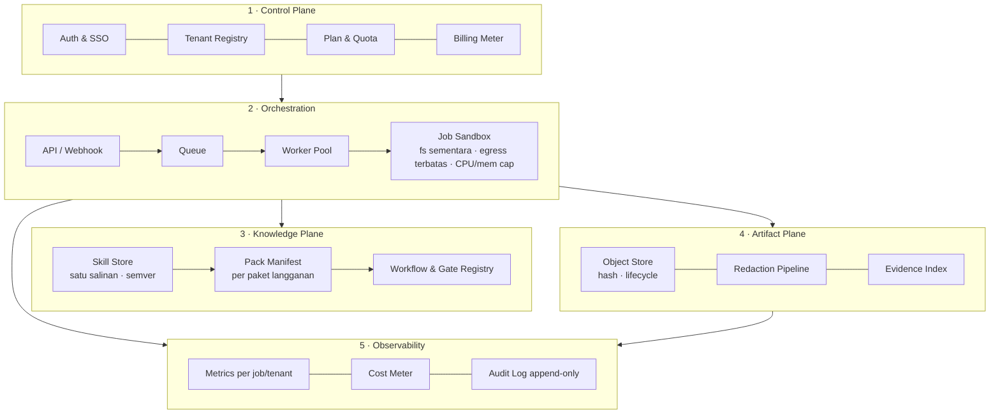

# Arsitektur Skala SDB — dari 1 Operator ke Ribuan Tenant

**Status**: rancangan fondasi (Fase 0) · **Tanggal**: 2026-10-26 · **Dasar**: `reports/SDB_DOUBLE_AUDIT_20261026.md`

Dokumen ini menjawab satu pertanyaan: **kalau SDB dijual sebagai langganan dan dipakai ribuan orang, bagian mana
yang harus diubah sekarang** — bukan nanti setelah pelanggan pertama mengeluh.

---

## 1. Lima prinsip yang mengunci semua keputusan lain

1. **Satu sumber kebenaran, banyak tampilan.** Skill, workflow, dan gate disimpan **sekali**; profil divisi dan
   paket langganan hanyalah *manifest* yang menunjuk ke sana. Tidak ada penyalinan.
2. **Repo produk ≠ gudang data pelanggan.** Git hanya untuk kode, kontrak, dan dokumen. Artefak, capture, log,
   dan evidence pelanggan hidup di object store dengan retensi dan hash.
3. **Isolasi per pekerjaan, bukan per mesin.** Setiap job berjalan di sandbox sendiri (namespace + fs sementara +
   egress terbatas). Skala datang dari banyak pekerja kecil, bukan satu mesin besar.
4. **Batas biaya adalah fitur, bukan efek samping.** Setiap job punya plafon token dan waktu sejak awal; kuota
   per paket ditegakkan di control plane, bukan di hati operator.
5. **Yang tidak bisa diaudit, tidak dirilis.** Setiap tenant punya jejak: siapa menjalankan apa, dengan skill
   versi berapa, menghasilkan artefak ber-hash apa.

---

## 2. Model tenancy — pilihan dan alasannya

| Model | Isolasi | Biaya/tenant | Cocok untuk | Keputusan |
|---|---|---|---|---|
| **Silo** (stack sendiri per tenant) | Tertinggi | Tinggi (×N) | Enterprise/regulasi | Hanya untuk paket Enterprise |
| **Pool + namespace** (DB & bucket bersama, `tenant_id` wajib, sandbox per job) | Tinggi secara operasional | Rendah | Mayoritas pelanggan | **Default** |
| **Bridge** (pool untuk data, silo untuk artefak sensitif) | Menengah-tinggi | Sedang | Pelanggan dengan data sensitif | Opsi paket Pro |

**Rekomendasi**: *pool + namespace* sebagai default; naik ke *bridge/silo* hanya bila pelanggan membayar untuk
itu. Kuncinya bukan "satu database per tenant", tetapi **tiga batas yang tidak boleh dilanggar**:

1. Setiap baris data punya `tenant_id`; query tanpa `tenant_id` ditolak di lapisan repository (bukan disiplin).
2. Setiap artefak berada di prefix `s3://sdb-artifacts/<tenant_id>/<job_id>/`.
3. Setiap kredensial pelanggan disimpan di vault dengan namespace `tenant/<id>` dan **tidak pernah** masuk
   environment proses pekerja bersama.

---

## 3. Lima lapisan target



### 3.1 Control plane (belum ada — blocker B-3)

Permukaan API minimum (jangan lebih dulu dari ini):

```text
POST /v1/tenants                 daftar tenant + plan
GET  /v1/tenants/{id}            status, kuota terpakai
POST /v1/tenants/{id}/keys       kunci API tenant (di-hash, ditampilkan sekali)
POST /v1/jobs                    {type, target_ref, pack_id, params}  -> job_id
GET  /v1/jobs/{id}               status, biaya token, artefak
GET  /v1/jobs/{id}/artifacts     daftar artefak + sha256 + signed URL
POST /v1/webhooks                callback selesai/gagal
GET  /v1/usage?period=month      meter untuk billing
```

Aturan: **tidak ada endpoint yang menerima path filesystem mentah**. Target selalu berupa referensi
(`artifact://`, `git://`, `upload://`) supaya worker tidak pernah menyentuh direktori host bersama.

### 3.2 Orchestration

- Queue berbasis database dulu (Postgres `SKIP LOCKED`) — cukup sampai ±50 job/menit, tanpa Kafka.
- Worker tanpa state; satu proses = satu job; hasil ditulis ke artifact store, bukan disk lokal.
- Sandbox: container rootless, `--read-only`, tmpfs, `--network none` kecuali target butuh egress (allowlist),
  CPU/mem/time cap. **Ini yang membuat "jalankan REA/browser/gdb" aman untuk multi-tenant.**
- Idempotency key per job; retry dengan backoff; dead-letter setelah 3 percobaan.

### 3.3 Knowledge plane (menyelesaikan H-1)

Hari ini: 39 skill × 8 profil × N tenant = salinan. Target:

```text
skills/                      satu-satunya sumber (repo, versi semver)
packs/<pack>@<semver>.json   manifest: daftar skill + workflow + gate + hash
~/.hermes/...                HANYA hasil materialisasi pack, ditandai pack_id + versi
```

- Profil divisi menjadi **view**: `pack: sdb-core@1.4.0` + `role: recon`.
- Rilis skill = tag + manifest ber-hash; rollback = tukar `pack_id` (bukan `git revert`).
- Pencabutan darurat: control plane menandai skill `revoked` → materialisasi berikutnya menghapusnya.
- Batas wajar: **≤25 skill aktif per peran**; di atas itu deskripsi mulai mengganggu pemilihan skill
  (indeks deskripsi saat ini hanya 1.275–2.474 token, jadi yang jadi masalah adalah relevansi, bukan ukuran).

### 3.4 Artifact plane (menyelesaikan H-2 dan B-4)

| Jenis | Tempat | Retensi default | Catatan |
|---|---|---|---|
| Evidence ter-normalisasi (JSON kecil) | object store + indeks di DB | 90 hari (Pro), 1 tahun (Enterprise) | selalu ber-hash, selalu `redaction_status` |
| Capture mentah (`.raw`, `.har`, screenshot) | object store, bucket terpisah | 7–30 hari | **tidak pernah** masuk git |
| Log job | object store, terkompresi | 30 hari | PII di-redact sebelum ditulis |
| Laporan akhir (md/pdf) | object store + salinan yang bisa diunduh | selama langganan | ini yang dilihat pelanggan |

Aturan keras: **satu berkas >512 KB tidak boleh masuk git**; **tidak ada email/NIK/nomor HP** di artefak yang
dilacak. Ditegakkan mesin lewat `make hygiene` (lihat `scripts/repo_hygiene.py`).

### 3.5 Observability & billing meter

Metrik minimum per job: `sdb_job_duration_seconds`, `sdb_job_tokens_total{phase}`, `sdb_job_cost_usd`,
`sdb_queue_depth`, `sdb_job_failures_total{reason}`, `sdb_sandbox_oom_total`.
Per tenant: job/bulan, token/bulan, storage GB, p95 durasi. Meter ini **adalah** dasar tagihan — bukan laporan
terpisah yang dibuat manual.

---

## 4. Kontrak data (fondasi yang bisa dieksekusi sekarang)

Skema ada di `platform/schemas/` dan divalidasi oleh `tests/test_platform_contracts.py`:

| Skema | Isi wajib | Mengapa |
|---|---|---|
| `tenant.schema.json` | `tenant_id`, `plan`, `status`, `created_at`, `limits{jobs_per_month,tokens_per_month,storage_gb}`, `isolation` | tanpa `limits` tidak ada penegakan kuota; tanpa `isolation` tidak ada janji privasi |
| `job.schema.json` | `job_id`, `tenant_id`, `type`, `pack{id,version}`, `target_ref`, `budget{tokens,seconds}`, `idempotency_key`, `status` | `budget` + `idempotency_key` mencegah dua masalah termahal: biaya tak terbatas dan job ganda |
| `artifact.schema.json` | `artifact_id`, `tenant_id`, `job_id`, `kind`, `sha256`, `size`, `redaction_status`, `retention_until`, `uri` | `redaction_status` wajib — artefak tanpa status redaksi tidak boleh dipublikasikan |

Semua `*_id` memakai ULID (sortable, tidak membocorkan jumlah tenant seperti auto-increment).

---

## 5. Kapasitas — hitungan dengan asumsi yang dinyatakan

> **Asumsi** (wajib divalidasi pada pilot pertama, jangan dipakai sebagai janji): 1 job = 35.000 token input +
> 6.000 output, 8 menit, 3 MB artefak; 1 tenant aktif = 2 job/hari; puncak = 40% job harian dalam 8 jam.

| Skala | Job/hari | Token input/hari | Storage/hari | Worker paralel (puncak) | Biaya LLM/bln* | Biaya infra/bln** |
|---|---:|---:|---:|---:|---:|---:|
| 10 tenant | 20 | 0,7 M | 60 MB | 1 | ~$120 | ~$60 |
| 100 tenant | 200 | 7 M | 0,6 GB | 3 | ~$1,2 k | ~$250 |
| **1.000 tenant** | 2.000 | 70 M | 6 GB | 27 | **~$11,7 k** | ~$1,5 k |
| 10.000 tenant | 20.000 | 700 M | 60 GB | 267 | ~$117 k | ~$12 k |

\* input $3/M + output $15/M (kelas Sonnet; model murah menurunkan angka ini drastis — itulah tuas margin utama).
\** 8 vCPU/16 GB per ±8 worker paralel + Postgres + object storage + observability.

**Pelajaran dari tabel**: biaya terbesar bukan server, tapi **token**. Karena itu `budget.tokens` per job dan
kuota per paket bukan fitur opsional — itu yang menentukan apakah langganan menghasilkan margin.

---

## 6. Unit economics & pagar harga

| Paket | Harga | Kuota job/bln | Token/bln (plafon) | Isolasi |
|---|---:|---:|---:|---|
| Starter | $49 | 60 | 2,5 M | pool |
| Pro | $149 | 250 | 12 M | pool + artifact bucket terpisah |
| Team | $399 | 800 | 40 M | pool + SSO |
| Enterprise | kontrak | custom | custom | silo / bridge |

Pagar yang harus ditegakkan mesin, bukan niat:
1. Job ditolak bila kuota habis (HTTP 402 + sisa kuota) — **bukan** dilanjutkan lalu ditagih belakangan.
2. Token per job dihentikan di 110% budget (partial result disimpan, status `budget_exceeded`).
3. Alert internal bila biaya satu tenant >60% harga paketnya di bulan berjalan.
4. Tidak ada "unlimited" di paket mana pun sampai biaya per job terbukti <15% harga.

---

## 7. SLO & SLA per paket

| Metrik | Starter | Pro | Enterprise |
|---|---|---|---|
| Availability API | 99,0%/bln | 99,9% | 99,95% |
| Waktu tunggu antre p95 | 10 menit | 3 menit | 1 menit |
| Durasi job p95 | 20 menit | 10 menit | 10 menit |
| Retensi artefak | 30 hari | 90 hari | 1 tahun |
| Dukungan | email 48 jam | email 24 jam | kanal khusus 4 jam |

SLO harus diukur dari metrik yang sudah ada di §3.5 — bukan dari survei.

---

## 8. Keamanan & kepatuhan untuk multi-tenant

| Kontrol | Implementasi |
|---|---|
| Isolasi data | `tenant_id` wajib di repository; test negatif: query lintas-tenant harus gagal |
| Isolasi eksekusi | sandbox per job, rootless, read-only rootfs, egress allowlist |
| Kredensial pelanggan | vault per `tenant/<id>`; tidak pernah di env worker bersama; rotasi otomatis 90 hari |
| Log & artefak | redaksi otomatis (email, token, NIK, nomor HP) sebelum simpan; `redaction_status` wajib |
| Audit log | append-only, hash-chained, retensi 1 tahun; setiap akses artefak tercatat |
| Penghapusan tenant | hard-delete terjadwal (30 hari): DB, bucket prefix, cache, backup snapshot |
| Supply chain | setiap tool pihak ketiga: pin + integritas + audit (pola REA) sebelum dipakai lintas tenant |

---

## 9. Lisensi — keputusan yang harus diambil Owner (blocker B-1)

Tiga opsi, tidak ada yang "benar" tanpa keputusan bisnis:

| Opsi | Isi | Konsekuensi |
|---|---|---|
| **A. Proprietary** | `LICENSE` = All rights reserved + EULA; pelanggan dapat hak pakai terbatas | Paling aman untuk langganan; komunitas/portofolio tertutup |
| **B. Open core** | Core MIT/Apache; fitur multi-tenant & enterprise proprietary | Butuh disiplin memisahkan direktori; nilai jual harus di lapisan produk |
| **C. Source-available** | Terlihat, dilarang dijual ulang (mis. BSL/Fair-Core) | Kompromi; perlu tanggal konversi & kejelasan hukum |

Terlepas dari pilihan: **pack CC-BY-SA (`trailofbits/skills`) tidak boleh dibundel** ke paket berbayar tanpa
atribusi + lisensi sama. Mitigasi: jadikan "Security Pack (third-party, CC-BY-SA)" sebagai paket terpisah yang
diaktifkan pelanggan sendiri, dengan `NOTICE` dan atribusi lengkap — atau ganti dengan implementasi internal.

---

## 10. Fase migrasi & kriteria selesai

| Fase | Isi | Selesai bila |
|---|---|---|
| **0 — fondasi (sekarang)** | Audit ganda, peta struktur, skema kontrak, gerbang higiene, baseline artefak | `make check` + `make hygiene` hijau; ADR tenancy & artifact tertulis |
| **1 — konsolidasi** | Skill store + pack manifest; artefak keluar dari git; tag `v0.1.0`; lisensi diputuskan; coverage baseline | repo <10 MB; 1 pack bisa dipasang/dicabut tanpa salinan; 1 tag |
| **2 — control plane** | API, auth, tenant registry, kuota, billing meter, queue + worker sandbox | 10 pilot terisolasi; 1 tagihan otomatis; metrik biaya per job |
| **3 — skala** | HA, SLO, self-serve, audit log, paket enterprise | 100 tenant; tidak ada insiden lintas-tenant; SLO terukur |

---

## 11. Yang **tidak** boleh dibangun sekarang (anti over-engineering)

- Kubernetes / service mesh — Postgres + beberapa worker cukup sampai ribuan tenant.
- Microservices per divisi — 8 divisi bukan 8 service; satu API + satu worker pool.
- Router LLM sendiri — pakai yang ada; optimasi biaya lewat pemilihan model per peran, bukan infrastruktur baru.
- Multi-region — tunggu sampai ada pelanggan yang benar-benar menuntut latensi/regulasi.
- UI dashboard baru sebelum API stabil — dashboard lokal `:8484` cukup untuk operasi internal.

---

## 12. Risiko yang tersisa

| Risiko | Level | Mitigasi |
|---|---|---|
| Asumsi biaya token meleset | HIGH | ukur pada 10 pilot; pagar kuota menahan kerugian |
| Pelanggan menyalahgunakan kapabilitas RE (analisis target tak berizin) | HIGH | Gate #0 tetap wajib; `target_ref` harus lolos verifikasi kepemilikan; log audit |
| Skill pihak ketiga dengan lisensi ketat | MEDIUM | karantina per pack + `NOTICE` + review legal |
| Ketergantungan satu maintainer tool kunci (mis. REA) | MEDIUM | pin versi + jalur ganti (abstraksi `analyzer` di worker) |
| Data pelanggan tersisa di artefak uji | MEDIUM | `make hygiene` + retensi + hard-delete terjadwal |

## Status implementasi (2026-10-29)

| Fase | Isi | Status |
|---|---|---|
| 0 | kontrak schema, peta struktur, gerbang higiene, ADR | **selesai** (`29a941d`) |
| 1 | lisensi BUSL-1.1, NOTICE, pack manifest, arsip artefak keluar git | **selesai** (`e5db5ac`, `ea2792d`) |
| 2a | control plane inti: tenant, kuota job/token/storage, job idempoten, artefak ber-redaksi | **selesai, teruji** (`sdb_platform/control_plane/`) |
| 2b | worker ber-lease, penagihan prabayar (ledger ber-rantai hash), invoice | **selesai, teruji** |
| 2c | gateway pembayaran, RBAC/SSO, rate limit, sandbox eksekusi, metrik | belum |
| 3 | isolasi silo, multi-region, SLO produksi | belum |

Yang sudah bisa dibuktikan sekarang: dua tenant tidak bisa saling membaca data, kuota menolak job ke-(limit+1),
retry idempoten tidak menggandakan pekerjaan, artefak tanpa status redaksi ditolak.
