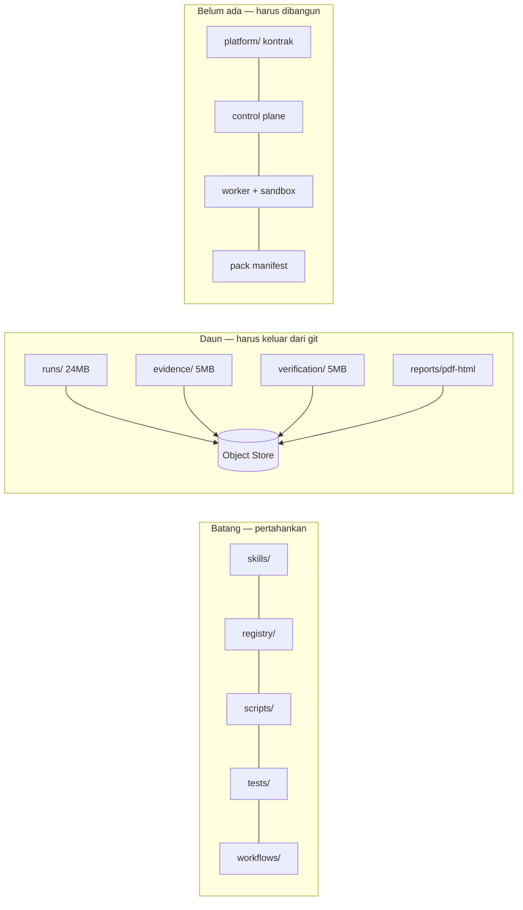

# Peta Struktur SDB — Sekarang vs Target

**Tanggal**: 2026-10-26 · **Dasar**: `reports/SDB_DOUBLE_AUDIT_20261026.md` · **Rancangan produk**: `docs/ARSITEKTUR_SAAS.md`

Dokumen ini adalah **peta**: di mana setiap hal berada hari ini, ke mana harus pindah, dan aturan supaya tidak
berantakan lagi saat tim/pelanggan bertambah.

---

## 1. Kondisi hari ini (terukur)

```text
super-dev-builders/            590 berkas · 39,36 MB · 20 MB dilacak git
├── agents/           8      definisi peran divisi (sdb-*)
├── skills/          79      39 skill custom (86 KB SKILL.md) — sumber tunggal ✅
├── scripts/         24      CLI internal (9.479 baris Python total repo)
├── tests/           16      252 tes
├── registry/         3      skills.yaml · tools.yaml · workflows? (sumber kebenaran ✅)
├── workflows/        3      gate0 · reconstruction-pipeline · release-gate
├── docs/            29      375 KB — blueprint, kebijakan, ADR informal
├── templates/        7      manifest otorisasi, template evidence
├── dashboard/       15      deck lokal :8484 (read-only)
├── runs/            202     24 MB ← artefak pelanggan di git ⚠
├── evidence/         78     5 MB ← capture & normalisasi ⚠
├── reports/          67     6 MB ← laporan + PDF/HTML duplikat ⚠
├── reconstruction/   20     1 MB
├── verification/      7     5 MB (diff visual 2,7 MB) ⚠
├── normalized/       12
├── targets/           5
├── state/             2
└── .github/workflows/ci.yml   lint + registry + test + drift ✅
```

**Diagnosis satu baris**: batangnya sehat (skills, scripts, registry, tests, workflows), **daunnya** yang
menumpuk (artefak 36 MB di empat direktori) dan **tidak ada lapisan produk** sama sekali.



---

## 2. Struktur target

```text
super-dev-builders/
├── platform/                  ← BARU · kontrak produk (tanpa kode bisnis)
│   ├── schemas/               tenant · job · artifact (+ contoh)
│   ├── packs/                 manifest paket langganan (core@1.0.0, security@…)
│   └── README.md              aturan apa yang boleh masuk sini
├── skills/                    sumber tunggal skill (versi via git tag)
├── registry/                  skills.yaml · tools.yaml (indeks + status)
├── scripts/                   CLI internal + gate (tetap)
├── tests/                     252+ tes, termasuk tes kontrak & higiene
├── workflows/                 gate0 · pipeline · release-gate
├── docs/
│   ├── adr/                   ← BARU · keputusan arsitektur bernomor
│   ├── runbooks/              ← BARU · prosedur operasi (deploy, rollback, insiden)
│   ├── policies/              ← BARU · keamanan, privasi, lisensi, token
│   └── archive/               ← BARU · dokumen lama & duplikat format
├── templates/                 manifest otorisasi, evidence
├── dashboard/                 deck lokal (tetap, internal)
└── .github/workflows/         ci.yml + hygiene (BARU)
```

**Yang hilang dari repo (pindah ke luar)**: `runs/`, `evidence/`, `verification/`, `normalized/`, `targets/`
(besar), dan PDF/HTML hasil generate. Repo hanya menyimpan **contoh kecil** (`templates/`, `fixtures/`) dan
**indeks** (`reports/INDEX.md`) yang menunjuk ke object store.

---

## 3. Tabel pemetaan (sekarang → target)

| Sekarang | Target | Cara | Risiko |
|---|---|---|---|
| `docs/*.md` kebijakan | `docs/policies/` | `git mv` + perbarui tautan | rendah |
| `docs/ARCHITECTURE.md`, `DIVISIONS.md` | tetap di `docs/` | — | — |
| `docs/AUDIT_20261007_R2/R3.md` | `docs/archive/` | `git mv` | rendah |
| `docs/INTEGRASI_GITHUB_VERCEL_SUPABASE.{html,pdf}` | `docs/archive/` (md tetap) | `git mv` | rendah |
| `reports/*.html`, `*.pdf`, `RESEARCH_*.pdf` | object store + `reports/INDEX.md` | unggah, hapus dari git | sedang (tautan) |
| `reports/*.md` | tetap, + `INDEX.md` | tambah indeks | rendah |
| `runs/`, `verification/`, `evidence/` (besar) | object store, prefix `tenant/<id>/` | arsip + `git rm --cached` | **tinggi** (riwayat) |
| `platform/`, `docs/adr/`, `docs/runbooks/` | dibuat sekarang | `mkdir` + isi | rendah |
| lisensi | `LICENSE` di root | keputusan Owner | rendah |

Catatan penting soal riwayat: menghapus berkas besar hari ini **tidak** mengecilkan `.git` (riwayat tetap).
Untuk repo produk, langkah pembersihan riwayat (filter-repo) dilakukan **sekali** di Fase 1, setelah arsip ke
object store terverifikasi. Sampai saat itu, aturan "tidak ada berkas baru >512 KB" yang menjaga agar tidak
bertambah buruk.

---

## 4. Aturan penempatan (decision tree) — untuk mencegah kekacauan berikutnya

```text
Apakah ini kode/konfigurasi yang dijalankan ulang oleh orang lain?
├── ya → scripts/ atau platform/ (kontrak, tanpa data)
└── tidak
    ├── Apakah ini hasil pekerjaan (capture, log, evidence, laporan generate)?
    │     ├── ya → OBJECT STORE (s3://sdb-artifacts/<tenant>/<job>/), bukan repo
    │     └── tidak
    ├── Apakah ini keputusan/desain yang perlu dibaca 6 bulan lagi?
    │     ├── ya → docs/adr/NNNN-judul.md (1 keputusan, 1 berkas, <1 halaman)
    │     └── tidak
    ├── Apakah ini prosedur yang dijalankan saat incident?
    │     ├── ya → docs/runbooks/
    │     └── tidak → docs/policies/ atau reports/ (temuan, bukan data mentah)
```

Batas keras yang ditegakkan mesin (`make hygiene`):
1. tidak ada berkas baru >512 KB di git (kecuali `platform/` skema/contoh);
2. tidak ada `*.raw`, `*.har`, `.env*`, kunci privat;
3. tidak ada email/NIK/nomor HP di artefak ter-lacak;
4. tidak ada `runs/` atau `evidence/` baru dengan >20 berkas tanpa indeks.

---

## 5. Migrasi bertahap (boleh berhenti di langkah mana pun)

**Langkah 1 — dokumen (hari ini, aman)**: buat `docs/adr/`, `docs/runbooks/`, `docs/policies/`, `docs/archive/`;
pindahkan dokumen lama; tambah `docs/INDEX.md`. Tidak menyentuh kode.
**Langkah 2 — kontrak (hari ini)**: `platform/schemas/` + contoh + tes kontrak. Tidak menyentuh runtime.
**Langkah 3 — gerbang higiene (hari ini)**: `scripts/repo_hygiene.py` + baseline + `make hygiene` + CI.
**Langkah 4 — arsip artefak (Fase 1)**: unggah `runs/evidence/verification` ke object store, verifikasi hash
per berkas (jumlah + sha256 cocok), baru `git rm --cached`. Rollback = pulihkan dari arsip (masih utuh).
**Langkah 5 — pembersihan riwayat (Fase 1, sekali)**: `git filter-repo` pada direktori yang sudah diarsipkan,
setelah tag `v0.1.0` dibuat di tempat aman. Ini satu-satunya langkah yang tidak bisa dibatalkan → butuh approval.

---

## 6. Verifikasi peta ini (bukan klaim)

```bash
cd ~/super-dev-builders
make check        # lint + registry + 252 tes + drift
make hygiene      # aturan penempatan §4
find . -path ./.git -prune -o -type f -size +512k -print | grep -v platform/   # harus kosong setelah Fase 1
du -sh .git       # target Fase 1: <15 MB
```
