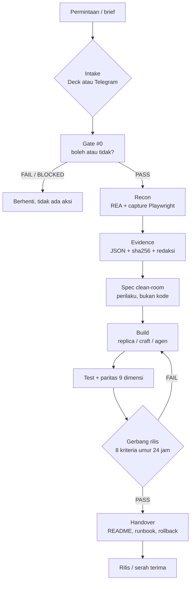
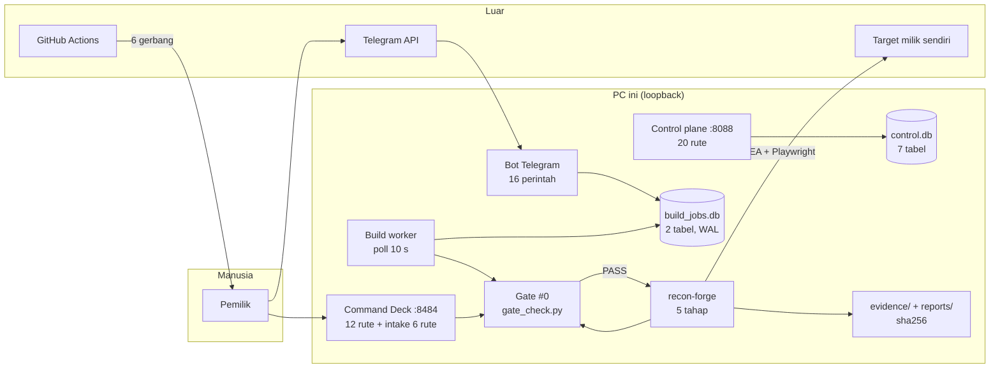

# SDB — Super Dev Builders: Dokumen Lengkap A–Z

**Versi dokumen:** 3.0 · **Tanggal:** 5 November 2026, 06:10 WIB
**Status:** aktif dikembangkan · **Repo resmi:** <https://github.com/anashadi-node/super-dev-builders> (publik — diverifikasi `gh repo view` 5 Nov 2026; pemilik `anashadi-node`)
**Cakupan:** seluruh sistem SDB — filosofi, tujuan, struktur, arsitektur, 18 tahap, gerbang, 12 divisi, 8 agen, 40 skill, 17 tool, CLI, Command Deck, control plane, basis data, penagihan, bot Telegram, alur build, laporan, keamanan, skenario operasional, batasan jujur, dan bukti verifikasi.

> **Cara membaca dokumen ini.** Bagian depan (Ringkasan Eksekutif + Peta Cepat) untuk Anda yang ingin tahu "ini apa" dalam 5 menit. Bab A–Z disusun seperti kamus: setiap huruf satu topik, berdiri sendiri, boleh dibaca melompat. Lampiran berisi angka mentah dan perintah untuk memverifikasi sendiri setiap klaim. Semua angka di dokumen ini diambil dari mesin pada 5 November 2026 pukul 06:05–06:10 WIB, bukan dari ingatan dan bukan dari dokumen lama.

---

## Ringkasan Eksekutif (1 halaman)

**SDB (Super Dev Builders)** adalah sistem kerja pengembangan perangkat lunak berbasis agen yang dibangun di atas Hermes Agent. Ia bukan satu aplikasi, melainkan **empat lapis yang saling mengunci**:

| Lapis | Isi | Status nyata hari ini |
|---|---|---|
| 1. **Perkakas & gerbang** | 31 skrip Python, 17 perintah `sdb`, Gate #0, release gate, evidence lint, security verdict, higiene repo | Berjalan; `make check` **PASS** |
| 2. **Pabrik rekonstruksi** | REA 6.8.0, `recon-forge`, capture Playwright, fidelity 9 dimensi, pipeline 18 tahap, 40 skill, 8 pack | Berjalan; uji nyata pada 3 target (forge-demo web + native, pilot Craft Anything) |
| 3. **Ruang kendali lokal** | Command Deck `127.0.0.1:8484`, intake 6 rute, 12 rute API, token 72-bit | **Aktif** |
| 4. **Platform SaaS** | Control plane `:8088`, 20 rute, 7 tabel, penagihan prabayar, buku besar rantai hash | Kode lengkap & teruji, **tetapi 0 tenant, 0 job, 0 rupiah**; layanan sedang **gagal start** karena `SDB_ADMIN_KEY` belum diset |

**Angka kunci (terverifikasi 5 Nov 2026):**

- 118 berkas Python terlacak, **23.207 baris** kode Python.
- **629 item tes** terkumpul di 50 berkas (`tests/` 533, sisanya `skills/` + `integrations/`); seluruh suite lulus dalam 49,83 s.
- **40 skill** buatan sendiri, **17 repo pihak ketiga** dievaluasi, **8 pack** divisi.
- **12 divisi** (D0–D11), **8 agen**, **8 profil Hermes**.
- **18 tahap** pipeline (bukan 16 — docstring lama salah).
- **6 gerbang mesin**: Gate #0, evidence lint, security verdict, release gate, higiene repo, runner tahap; plus **7 gerbang `make check`**.
- **160 berkas Markdown** terlacak, 53 di antaranya di `docs/`.
- 6 direktori target, 5 direktori run, 10 direktori evidence, 30 berkas laporan.
- Control plane: **3.044 kali restart** sejak konfigurasi rusak (bukti di `journalctl`, 5 Nov 06:06).

**Satu kalimat jujur tentang status:** SDB adalah **perkakas pribadi yang matang dan teruji di level mekanis**, dengan satu komponen bisnis (control plane) yang kodenya selesai tetapi belum pernah dipakai satu pelanggan pun, dan saat ini sedang mati karena kunci admin belum diisi. Klaim "SaaS siap jual" **tidak** didukung data.

---

## Peta Cepat (5 menit)



**Tiga aturan yang mengikat seluruh sistem:**

1. **Tidak ada aksi tanpa izin.** `gate_check.py` adalah satu-satunya sumber "boleh/tidak". Tanpa `gate0-verdict.json` ber-verdict `PASS`, `recon-forge` berhenti dengan exit 2.
2. **Tidak ada klaim tanpa bukti.** Yang tidak terukur ditulis `UNPROVEN`, bukan dianggap lulus. `release_ready` selalu `false` sampai ada approval manusia.
3. **Fail-closed, bukan fail-open.** Alat tidak ada = `BLOCKED`. Kunci worker tidak diset = `503`. Chat ID salah = bot diam total.

---

## Daftar Isi

| Bab | Topik | Untuk siapa |
|---|---|---|
| [A](#a-apa-itu-sdb) | Apa itu SDB | semua |
| [B](#b-kenapa-sdb-dibuat) | Kenapa SDB dibuat | pemilik produk |
| [C](#c-filosofi-dan-prinsip) | Filosofi & prinsip | semua |
| [D](#d-tujuan-dan-target-terukur) | Tujuan & target terukur | pemilik, manajer |
| [E](#e-struktur-repo-dan-peta-berkas) | Struktur repo & peta berkas | developer baru |
| [F](#f-arsitektur-sistem) | Arsitektur sistem | developer, arsitek |
| [G](#g-dua-belas-divisi-dan-delapan-agen) | 12 divisi & 8 agen | operator |
| [H](#h-siklus-18-tahap) | Siklus 18 tahap | operator, QA |
| [I](#i-gerbang-dan-bukti-semua-aturan-angka) | Gerbang & bukti (semua angka) | QA, keamanan |
| [J](#j-mode-ab-dan-kebijakan-clone) | Mode A/B & kebijakan clone | legal, keamanan |
| [K](#k-rea-680-mesin-bukti-zona-a) | REA 6.8.0 — mesin bukti | recon |
| [L](#l-recon-forge-orkestrator-lima-tahap) | recon-forge | recon, arsitek |
| [M](#m-registry-skill-dan-tool) | Registry skill & tool | semua |
| [N](#n-pack-divisi-dan-pagar-25-skill) | Pack divisi & pagar 25 skill | arsitek |
| [O](#o-cli-sdb-31-skrip-17-perintah) | CLI `sdb` | operator |
| [P](#p-command-deck-8484) | Command Deck `:8484` | operator |
| [Q](#q-control-plane-8088) | Control plane `:8088` | bisnis, backend |
| [R](#r-basis-data-tujuh-tabel) | Basis data | backend |
| [S](#s-penagihan-prabayar-dan-buku-besar-rantai-hash) | Penagihan & ledger | bisnis |
| [T](#t-bot-telegram-16-perintah) | Bot Telegram | operator |
| [U](#u-alur-build-dari-kalimat-ke-aplikasi) | Alur `/build` | operator |
| [V](#v-laporan-4-jam-dan-observabilitas) | Laporan 4 jam | operator |
| [W](#w-keamanan-model-ancaman-dan-rahasia) | Keamanan & ancaman | keamanan |
| [X](#x-skenario-operasional-dan-troubleshooting) | 10 skenario & troubleshooting | operator |
| [Y](#y-batasan-jujur-dan-utang-teknis) | Batasan jujur & utang teknis | pemilik |
| [Z](#z-bukti-verifikasi-dan-lampiran) | Bukti verifikasi & lampiran | auditor |
| [Lampiran 1](#lampiran-1-angka-vs-sumber) | Angka vs sumber | auditor |
| [Lampiran 2](#lampiran-2-glosarium-bahasa-awam) | Glosarium | non-teknis |
| [Lampiran 3](#lampiran-3-riwayat-dokumen) | Riwayat dokumen | semua |
| [Lampiran 4](#lampiran-4-peta-dokumen-rujukan) | Peta dokumen rujukan | semua |
| [Lampiran 5](#lampiran-5-checklist-verifikasi-mandiri) | Checklist verifikasi mandiri | auditor |

---

# A — Apa itu SDB

## A.1 Definisi satu paragraf

SDB adalah **sistem produksi perangkat lunak berbasis agen** yang mengubah satu brief menjadi aplikasi jadi melalui 18 tahap yang setiap tahapnya menuntut bukti berkas, bukan laporan lisan. Ia menggabungkan tiga hal yang biasanya terpisah: (1) **perkakas rekayasa** (recon, capture, paritas, gerbang), (2) **organisasi virtual** (12 divisi, 8 agen dengan batas wewenang tertulis), dan (3) **pabrik produk** (antrean job, worker build, bot Telegram, control plane multi-penyewa).

## A.2 Tiga identitas yang harus dibedakan

Sering terjadi salah paham karena satu kata "SDB" dipakai untuk tiga hal berbeda. Tabel ini memisahkannya secara tegas.

| Identitas | Apa itu | Di mana | Siapa yang memakai |
|---|---|---|---|
| **SDB-repo** | Repo tunggal `~/super-dev-builders` berisi kode, skill, dokumen, gerbang | Disk lokal + GitHub privat | Anda, agen, CI |
| **SDB-runtime** | Proses yang berjalan: Deck `:8484`, control plane `:8088`, bot Telegram, worker build | systemd user units | Anda sehari-hari |
| **SDB-metode** | Cara kerja: Gate #0 → recon → spec clean-room → build → paritas → gerbang rilis | Tercermin di 18 tahap + 40 skill | Siapa pun yang mengikuti SOP |

Ketiganya berbagi nama tetapi punya siklus hidup berbeda: repo bisa di-clone di mesin lain; runtime hanya hidup di PC ini; metode bisa dipakai manual tanpa menjalankan satu pun layanan.

## A.3 Apa yang SDB **bukan**

Kejujuran di depan mencegah kekecewaan belakangan:

| Bukan | Alasannya |
|---|---|
| Bukan alat untuk menyalin situs/aplikasi orang lain | Hanya target milik sendiri dengan izin tertulis (Mode B + `deep_analysis_allowed: true`) yang boleh dianalisis mendalam; Mode A hanya observasi permukaan |
| Bukan pengganti penilaian manusia | `release_ready` selalu `false`; rilis butuh approval tercatat |
| Bukan SaaS yang sudah berpenghasilan | 0 tenant, 0 job, 0 invoice di `control.db` |
| Bukan sistem multi-pengguna yang tahan serangan | Control plane punya isolasi tenant di level query, tetapi belum ada rotasi kunci, refund, atau audit eksternal |
| Bukan orkestrator container | Build berjalan sebagai user Anda, dijaga instruksi + direktori kerja, bukan sandbox kernel |

## A.4 Siapa yang dilayani

| Peran | Kebutuhan | Bagian SDB yang dipakai |
|---|---|---|
| **Pemilik (Mas Anas)** | Mengubah ide jadi produk tanpa kehilangan jejak bukti | Bot Telegram, Deck, 18 tahap |
| **Operator recon** | Memanen bukti sah dari target sendiri | REA, `recon-forge`, Gate #0 |
| **Arsitek** | Membaca hasil recon → desain & ADR | 11 skill arsitek, pack `sdb-architect` |
| **Builder** | Menulis kode clean-room tanpa melihat kode target | Pack `sdb-builder` (25 skill, tanpa REA) |
| **Reviewer/QA** | Menguji klaim paritas | `fidelity_compare`, 9 dimensi |
| **Auditor keamanan** | Memastikan tidak ada kebocoran | semgrep, syft, trivy, `security_verdict` |
| **Calon pelanggan (nanti)** | Menyuruh SDB mengerjakan job | Control plane `:8088` (belum ada pelanggan) |

## A.5 Satu hari di SDB (narasi konkret)

06:00 — timer `sdb-report-4h` mengirim ringkasan ke Telegram: layanan hidup, proyek yang git-nya kotor, antrean build.
08:30 — `sdb-deck-health` memeriksa 10 profil agen; 3 profil merah dicatat di `dashboard/state/health.json`.
09:10 — Anda mengirim `/build Website katalog villa…`. Bot menulis satu baris di `build_jobs.db`, worker mengambilnya, agen spesifikasi menulis `SPEC.md` + `PLAN.md` + `QUESTIONS.md` dalam 2–5 menit.
09:15 — Bot membalas ringkasan ≤1200 karakter dan menunggu `/approve`.
09:16 — Anda `/approve 3`. Worker menjalankan ronde build 1–3, tiap ronde punya batas waktu dan pagar larangan menyentuh `~/.hermes`, `~/anantara-sakti`, kredensial.
10:02 — Job `done`. Folder hasil berisi `README.md`, `VERIFY.md`, `GAPS.md`. Yang tidak selesai ditulis di `GAPS.md`, bukan disembunyikan.
Siang — Anda membuka Deck `:8484`, melihat 18 tahap per proyek, menjalankan satu tahap yang `MISSING`.
Sore — Anda commit. `make check` menyalakan 7 gerbang; CI GitHub menyalakan 6 gerbang yang sama (tanpa security/release gate).
Malam — Anda menjalankan `security_verdict` dan `release_check` manual, karena CI sengaja tidak menjalankannya.

---

# B — Kenapa SDB dibuat

## B.1 Masalah yang nyata (bukan karangan)

Sebelum SDB, pekerjaan rekonstruksi dan pengembangan dilakukan dengan cara ad-hoc. Lima masalah berulang:

| # | Masalah | Gejala yang terasa | Akar sebab |
|---:|---|---|---|
| 1 | **Klaim tanpa bukti** | "Recon selesai" ternyata hanya ada satu berkas JSON kosong | Tahap diperiksa keberadaan berkas, bukan cara memperolehnya |
| 2 | **Satu agen menilai pekerjaannya sendiri** | Bug lolos karena tidak ada pemeriksa independen | Tidak ada pemisahan peran |
| 3 | **Izin bersifat prosa** | Aturan "jangan sentuh target pihak ketiga" hanya tulisan | Tidak ada gerbang mesin yang bisa gagal |
| 4 | **Pengetahuan hilang** | Cara melakukan sesuatu diulang dari nol tiap proyek | Tidak ada skill/prosedur yang bisa dipakai ulang |
| 5 | **Biaya tak terbatas** | Agen mengulang perbaikan tanpa akhir | Tidak ada batas putaran/anggaran |

## B.2 Keputusan desain yang lahir dari masalah itu

| Masalah | Keputusan | Bukti penerapan |
|---|---|---|
| Klaim tanpa bukti | Setiap tahap menuntut **glob bukti**; `release_ready=false` default | `scripts/workflow_run.py`, `tools/recon-forge.py` |
| Self-approval | **12 divisi, 8 agen**, `sdb-security` dilarang menyetujui pekerjaannya sendiri | `agents/*.yaml` bagian `permissions.forbidden` |
| Izin prosa | **Gate #0** dengan 8 tindakan terlarang + 5 jenis data terlarang, verdict mesin | `scripts/gate_check.py` |
| Pengetahuan hilang | **40 skill** + **8 pack** + registry ber-hash | `registry/skills.yaml`, `platform/packs/*.json` |
| Biaya tak terbatas | `max_repair_cycles: 3`, `SDB_SPEC_TURNS=40`, `SDB_BUILD_TURNS=300`, timeout per ronde | `agents/sdb-orchestrator.yaml`, `scripts/sdb_build_worker.py` |

## B.3 Alternatif yang ditolak (dan alasannya)

| Alternatif | Kenapa ditolak |
|---|---|
| Pakai satu agen "super" tanpa peran | Tidak ada pemeriksa independen; kesalahan sistematis tidak terdeteksi |
| Pakai framework orkestrasi berat (LangGraph, CrewAI) | Menambah dependensi dan lapisan abstraksi; SDB butuh determinisme dan bisa diaudit baris per baris |
| Menjalankan semuanya di cloud | Data target sensitif; kontrol lokal lebih penting daripada skalabilitas awal |
| Menyimpan status hanya di basis data | Bukti harus berupa berkas nyata di disk supaya bisa diperiksa `sha256`-nya dan tetap ada setelah crash |
| Memakai `npx` untuk REA | `npx` selalu mengambil versi terbaru → kode yang berjalan bisa berubah minggu depan; dipilih versi terpin + node terpin |

## B.4 Garis waktu kelahiran (dari git, bukan cerita)

| Tanggal | Peristiwa | Bukti |
|---|---|---|
| 30 Okt 2026 | Penjaga CI + alarm kegagalan baru (idempoten, gagal-closed) | commit `344ed8c`, `fc717b5` |
| 30 Okt 2026 | Benchmark E1 pilot, gerbang G1, audit-log, uji IDOR tahap 11 | `90fe462` |
| 31 Okt 2026 | Command Deck revisi premium (glass, animasi, falsified) | `2c401d9` |
| 1 Nov 2026 | Deck skenario-driven v3 — 10 jalur, 18 tahap, data live | `17db0fd` |
| 1 Nov 2026 | Intake → tahap workflow (brief jadi konteks) | `48146f3` |
| 3 Nov 2026 | Laporan 4 jam, tanya-jawab ekosistem, perintah build | `852c0ab` |
| 4 Nov 2026 | **recon-forge** — orkestrator REA + gate + paritas | `f7df16d` |
| 4 Nov 2026 | Jalur native REA (ELF/Ghidra) + digest pohon | `b796690`, `372524c` |
| 4 Nov 2026 | Jalur `owned` untuk Mode B diikat ke akun OS | `a291151` |
| 4 Nov 2026 | Dokumen paket update v2.0 (32 bagian) | `c60fecb` |
| 5 Nov 2026 | Dokumen ini (v3.0, A–Z) | commit menyusul |

---

# C — Filosofi dan prinsip

## C.1 Tujuh prinsip yang mengikat

| # | Prinsip | Arti operasional | Konsekuensi bila dilanggar |
|---:|---|---|---|
| 1 | **Izin dulu, kerja kemudian** | Gate #0 PASS sebelum satu perintah menyentuh target | `recon-forge` exit 2, tidak ada aksi |
| 2 | **Bukti mengalahkan narasi** | Setiap klaim "selesai" butuh berkas + `sha256` + perintah | Tahap `MISSING`, bukan `OK` |
| 3 | **Fail-closed** | Alat tidak ada = BLOCKED; kunci tidak diset = 503 | Sistem berhenti, bukan menebak |
| 4 | **Pemeriksa tidak boleh jadi pembangun** | Builder tidak memegang REA; security tidak menyetujui pekerjaan sendiri | Batas ADR-0003 |
| 5 | **Yang tidak terukur ditulis UNPROVEN** | 4 dari 9 dimensi paritas tidak diukur → ditulis apa adanya | Laporan tidak mengarang angka |
| 6 | **Ulang tidak boleh menghapus bukti** | Menjalankan tahap ulang mengganti nama berkas lama jadi `.prev` | Jejak audit tetap ada |
| 7 | **Batas biaya itu bagian desain** | 3 ronde, 40/300 putaran, timeout per tahap | Tidak ada loop abadi |

## C.2 "Clean-room" — apa artinya secara teknis

Clean-room berarti **pembangun tidak melihat artefak mentah target**. Di SDB ini ditegakkan bukan dengan janji, tetapi dengan pembagian alat:

```
Zona A (boleh melihat target)          Zona B (hanya boleh melihat spesifikasi)
──────────────────────────────         ────────────────────────────────────────
REA 6.8.0                              sdb-builder
capture_web.py                         sdb-frontend
normalize_capture.py                   craft-anything / replica-skill
fidelity_compare.py
        │                                        ▲
        └──── evidence/*.json ──▶ SPEC.md ───────┘
              (perilaku)         (tanpa kode)
```

Bukti bahwa ini bukan sekadar niat: `pack` untuk `sdb-builder`, `sdb-frontend`, dan `sdb-devops` **tidak memuat** skill REA (§N). Kalau builder memegang alat reverse engineering, batas clean-room hanya kesepakatan lisan.

## C.3 Hierarki kebenaran

Ketika dua sumber bertentangan, urutan yang dipakai:

1. **Kode yang berjalan** (dan tesnya) — sumber tertinggi.
2. **Berkas bukti di disk** (`evidence/`, `reports/`, `runs/`) dengan `sha256`.
3. **Registry** (`registry/*.yaml`) — niat yang dinyatakan mesin.
4. **Dokumen** — termasuk dokumen ini.
5. **Ingatan/percakapan** — paling rendah.

Contoh nyata penerapan: docstring `workflow_run.py` menulis "16 tahap", tetapi daftarnya 18 baris. Yang dipakai angka 18, dan selisih itu dicatat sebagai temuan, bukan dirapikan diam-diam.

## C.4 Etika data

| Aturan | Alasan |
|---|---|
| Tidak pernah mengambil `credentials`, `session_tokens`, `cookies`, `payment_data`, `private_user_data` | Bukan kebutuhan teknis; risikonya jauh lebih besar dari manfaatnya |
| Redaksi sebelum masuk prompt | `retention.redact_before_prompt` wajib `true` di manifest |
| Retensi mentah 30 hari (template) | Cukup untuk audit, tidak menumpuk selamanya |
| Nama berkas disanitasi | Mencegah path traversal dan eksekusi tak sengaja |
| Media pelanggan tidak boleh terlacak git | Kanal `privasi-media` memindai ini |

---

# D — Tujuan dan target terukur

## D.1 Tujuan produk (apa yang ingin dicapai)

| Kode | Tujuan | Ukuran keberhasilan | Status 5 Nov 2026 |
|---|---|---|---|
| **T1** | Satu brief → aplikasi yang bisa dijalankan | Job `done` + `README.md` berisi perintah yang benar-benar jalan | Teralatih, belum ada job nyata tercatat di `build_jobs.db` pada sesi ini |
| **T2** | Rekonstruksi terukur, bukan opini | `mean_coverage` 9 dimensi + artefak ber-hash | 5/9 dimensi terukur pada `forge-demo`, `mean_coverage=0,9951` |
| **T3** | Tidak ada aksi tanpa izin | 100% aksi target didahului `gate0-verdict.json` PASS | Diuji 21 tes `test_recon_forge.py` |
| **T4** | Bisa dijual sebagai layanan | Tenant, job, invoice, ledger berfungsi | Kode + 103 tes terkait; **0 tenant** |
| **T5** | Pengetahuan tidak hilang | 40 skill ber-hash, 8 pack tervalidasi | PASS di `make packs` |

## D.2 Tangga status (bukan biner lulus/gagal)

SDB memakai tangga, karena "mirip" bukan nilai biner:

| Tingkat | Arti | Siapa yang menetapkan |
|---|---|---|
| `MISSING` | artefak tidak ada | mesin |
| `PRESENT` | artefak ada, belum dinilai | mesin |
| `MEASURED` | ada angka pengukuran | mesin (`fidelity_compare`) |
| `VERIFIED` | angka + `sha256` + dapat direproduksi | mesin + reviewer |
| `PASS` | memenuhi ambang yang ditetapkan | mesin |
| `release_ready` | **selalu `false`** sampai approval manusia tercatat | manusia |

## D.3 Target kuantitatif yang realistis (dan yang tidak)

| Target | Angka | Dasar | Catatan jujur |
|---|---|---|---|
| Waktu spesifikasi | 2–5 menit | pengamatan operasional | bisa lebih lambat bila model antre |
| Waktu build per ronde | 10–40 menit | `SDB_BUILD_TIMEOUT=3600` | timeout mematikan proses, bukan menghentikan biaya token |
| Ronde maksimum | 3 | `SDB_BUILD_ROUNDS=3` | setelah 3 gagal → eskalasi manusia |
| Paritas minimum untuk rilis | tidak ada ambang mesin | — | ambang ditetapkan manusia per proyek |
| Pelanggan pertama | belum ada | — | jangan klaim ada |
| Pendapatan | Rp0 | `ledger` 0 baris | jangan klaim ada |

**Yang sengaja TIDAK dijanjikan:** "100% identik", "otomatis tanpa manusia", "aman untuk target pihak ketiga". Ketiganya tidak didukung mekanisme yang ada.

---

# E — Struktur repo dan peta berkas

## E.1 Peta tingkat atas (dengan ukuran nyata)

| Folder/berkas | Isi | Ukuran/isi nyata |
|---|---|---|
| `sdb_platform/` | Kode platform: control plane, runtime, billing, tenancy | inti bisnis |
| `scripts/` | 31 skrip operasional (gate, capture, workflow, bot, worker) | lihat §O |
| `skills/` | 40 skill buatan sendiri (masing-masing `SKILL.md`) | 40 direktori |
| `dashboard/` | Command Deck: `server.py`, `ws_api.py`, `inbox_api.py`, state | `:8484` |
| `platform/` | Pack (8 JSON), skema, baseline higiene, allowlist HTML | kontrak mesin |
| `registry/` | `skills.yaml` (v2.2.0), `tools.yaml` | sumber kebenaran niat |
| `agents/` | 8 YAML agen: misi, izin, larangan, batas | kontrak peran |
| `workflows/` | `gate0.yaml`, `release-gate.yaml` | ambang gerbang |
| `governance/policies/` | `clone-policy.md` | aturan mengikat |
| `tools/` | `recon-forge.py` (45 KB), `scan-keamanan.sh`, `scan-privasi-media.py`, `arsitektur_verdict.py` | perkakas berat |
| `tests/` | 42 berkas, 533 item tes (629 bila `skills/` + `integrations/` ikut) | gerbang mutu |
| `docs/` | 52 berkas Markdown (40 top-level, 9 ADR, 2 arsip, 1 lain) | pengetahuan |
| `targets/` | 6 target (5 nyata + 1 contoh `nama-target`) | subjek uji |
| `runs/` | 5 direktori run (state, log, planora) | jejak eksekusi |
| `evidence/` | 10 direktori bukti ber-hash | bukti |
| `reports/` | 30 berkas laporan & verdict | laporan |
| `data/` | `control.db` (7 tabel, 0 baris) | basis data bisnis |
| `audit/` | `audit-log.jsonl` rantai hash | jejak tak terputus |

## E.2 Pohon yang lebih dalam (berkas yang paling sering dibuka)

```
super-dev-builders/
├── Makefile                     # 7 gerbang: lint lint-registry test drift hygiene packs docs-lint
├── pyproject.toml               # ruff + pytest config
├── README.md                    # wajib memuat tautan repo resmi (diuji docs_lint)
├── docs/
│   ├── INDEX.md                 # wajib: setiap .md baru terindeks di sini
│   ├── adr/0001..0008           # 9 ADR (dua bernomor 0008)
│   ├── WORKFLOW_GATES.md        # aturan gerbang & siklus perbaikan
│   ├── PETA_STRUKTUR.md         # peta struktur
│   ├── RECON_FORGE.md           # dokumen alat recon-forge
│   ├── RECON_NATIVE.md          # jalur biner
│   ├── REA_VS_CRAFT_ANYTHING_20261104.md
│   ├── CRAFT_ANYTHING_PILOT_0.3.0.md
│   └── PAKET_UPDATE_SDB_20261104.md   # dokumen v2.0 (2.358 baris)
├── scripts/
│   ├── sdb.py                   # dispatcher 17 perintah
│   ├── gate_check.py            # Gate #0
│   ├── workflow_run.py          # runner 18 tahap
│   ├── release_check.py         # 8 kriteria rilis
│   ├── evidence_lint.py         # validasi bukti
│   ├── security_verdict.py      # 2 kanal keamanan
│   ├── repo_hygiene.py          # R1..R5
│   ├── sdb_tg_bot.py            # 16 perintah Telegram
│   ├── sdb_build_worker.py      # worker build
│   ├── sdb_report.py            # laporan 4 jam
│   └── ...
├── sdb_platform/
│   ├── control_plane/app.py     # 20 rute FastAPI
│   ├── control_plane/store.py   # 7 tabel, transaksi uang
│   └── runtime/                 # worker lease, heartbeat
└── tools/
    └── recon-forge.py           # gate → recon → paritas → laporan
```

## E.3 Berkas yang tidak boleh ada di git

| Berkas | Alasan | Dijaga oleh |
|---|---|---|
| `.env`, `*.pem`, `*.key`, `id_rsa*` | rahasia | `repo_hygiene.py` R2 → FAIL |
| `*.pdf` hasil generate | duplikat sumber `.md` | `docs_lint.py` → FAIL |
| `.html` hasil generate (kecuali berdaftar) | duplikat, cepat usang | `docs_lint.py` + allowlist |
| `*.raw`, `*.har` | data mentah besar & sensitif | R2 |
| `identity-scan.json` (SDB) | data identitas | `.gitignore` |

## E.4 Cara memverifikasi struktur ini sendiri

```bash
cd ~/super-dev-builders
git ls-files | wc -l                      # jumlah berkas terlacak
git ls-files '*.py' | xargs wc -l | tail -1
ls -d skills/*/ | wc -l                   # harus 40
ls platform/packs/*.json | wc -l          # harus 8
python3 scripts/docs_lint.py              # indeks & HTML
```

---

# F — Arsitektur sistem

## F.1 Diagram komponen (dengan batas kepercayaan)



## F.2 Empat aliran data

| Aliran | Dari → Ke | Isi | Sifat |
|---|---|---|---|
| **Intake** | Deck/Telegram → `~/sdb-workspace/intake/<stamp>/` | `meta.json`, `brief.md`, `files/` | tulis sekali, tak berubah |
| **Bukti** | `recon-forge` → `evidence/<t>/` | JSON + sha256 + digest pohon | append-only |
| **Keputusan** | gerbang → `reports/<t>/*-verdict.json` | PASS/FAIL/BLOCKED | append-only |
| **Uang** | control plane → `control.db` | hold/settle/release + ledger | transaksi `BEGIN IMMEDIATE` |

## F.3 Isolasi kegagalan (desain, bukan kebetulan)

| Komponen mati | Yang tetap jalan | Bukti |
|---|---|---|
| Control plane | Bot, worker, Deck | DB terpisah (`control.db` vs `build_jobs.db`) |
| Bot Telegram | Worker (antrean tetap), Deck | Worker poll DB, tidak butuh bot |
| Deck | Bot, worker, control plane | Deck hanya membaca state + intake |
| `hermes-gateway` | Semua yang tidak memanggil model | Worker gagal dengan error jelas, bukan data palsu |

## F.4 Titik tunggal kegagalan (jujur)

| Titik | Dampak | Mitigasi hari ini | Mitigasi yang belum ada |
|---|---|---|---|
| `hermes-gateway` (model) | Semua agen berhenti | systemd restart | belum ada fallback provider |
| PC ini | Seluruh sistem berhenti | — | belum ada replika |
| `control.db` (satu berkas SQLite) | Riwayat bisnis hilang bila disk rusak | transaksi + FK | **belum ada backup otomatis** |
| Kunci `SDB_ADMIN_KEY` | Control plane mati (sedang terjadi) | — | belum ada `EnvironmentFile` tervalidasi |
| Token Deck 72-bit | Akses lokal | rate limit 30/60 s | belum ada rotasi |

---

# G — Dua belas divisi dan delapan agen

## G.1 Mengapa dipisah

Satu model yang mengerjakan semuanya cenderung menganggap pekerjaannya sendiri benar. Memisahkan peran memaksa adanya pemeriksa yang **tidak punya kepentingan atas hasil**. Ini alasan struktural, bukan formalitas.

## G.2 Peta divisi → agen → profil Hermes

```
12 DIVISI (tanggung jawab)          8 AGEN                 8 PROFIL HERMES
D0  Orchestrator  ───────┐
D1  Recon                 │
D2  Produk                ├──▶ sdb-orchestrator ──▶ cc-orchestrator
D3  Arsitek               │    sdb-recon        ──▶ cc-capture-forensics
D4  Frontend              │    sdb-architect    ──▶ cc-architect
D5  Backend               │    sdb-builder      ──▶ cc-builder
D6  Reviewer              │    sdb-frontend     ──▶ cc-frontend
D7  QA                    │    sdb-reviewer     ──▶ cc-reviewer-qa
D8  Keamanan              │    sdb-security     ──▶ cc-security-governor
D9  Audit                 │    sdb-devops       ──▶ cc-devops-docs
D10 DevOps/Rilis          │
D11 Dokumentasi/handover  ┘
```

Catatan: satu agen bisa memegang dua divisi. `sdb-reviewer` memegang D6+D7; `sdb-devops` memegang D10+D11.

## G.3 Tabel lengkap delapan agen

| Agen | Profil | Divisi | Tugas inti | Model utama (niat) | Model terpasang |
|---|---|---|---|---|---|
| `sdb-orchestrator` | `cc-orchestrator` | D0, D2 | permintaan → requirements & task graph | `deepseek-v4.1-flash` | `deepseek-flash` |
| `sdb-recon` | `cc-capture-forensics` | D1 | observasi sah, evidence, normalisasi | `glm-5.3-flash` | `z-ai/glm-5.3-flash` |
| `sdb-architect` | `cc-architect` | D3, D2 | arsitektur, ADR, rencana | `sonnet-5.5` | `claude-sonnet-5-5` |
| `sdb-builder` | `cc-builder` | D5 | backend clean-room + tes | `deepseek-v4.1-flash` | `deepseek-flash` |
| `sdb-frontend` | `cc-frontend` | D4 | frontend clean-room | `glm-5.3-flash` | `z-ai/glm-5.3-flash` |
| `sdb-reviewer` | `cc-reviewer-qa` | D6, D7 | review independen + QA | `sonnet-5.5` | `claude-sonnet-5-5` |
| `sdb-security` | `cc-security-governor` | D8, D9 | security gate + audit | `sonnet-5.5` | `claude-opus-5-5` |
| `sdb-devops` | `cc-devops-docs` | D10, D11 | rilis, deploy, dokumentasi | `deepseek-v4.1-flash` | `deepseek-flash` |

Penyimpangan yang tercatat: `sdb-security` memakai `claude-opus-5-5` walau field `primary` menulis `sonnet-5.5`, karena tahap D9 wajib model kuat; bila belum ter-wire, verdict ditandai `interim` (`agents/sdb-security.yaml:23,26`).

## G.4 Batas wewenang (kontrak yang dibaca mesin)

Setiap YAML punya empat daftar: `read`, `write`, `execute`, `forbidden`. Contoh `sdb-security`:

| Izin | Isi |
|---|---|
| **read** | seluruh proyek, artefak scan, SBOM |
| **write** | **hanya** `reports/security-gate.md` dan `reports/assurance-audit.md` |
| **execute** | semgrep, codeql, trivy, syft, dependency audit, secret scan, query read-only |
| **forbidden** | deploy produksi, modifikasi kode, menyetujui pekerjaan sendiri, memaksa scanner lolos |

Contoh `sdb-devops`:

| Izin | Isi |
|---|---|
| **execute** | docker compose, pipeline build, deploy ke staging, smoke test, backup |
| **produksi** | hanya dengan approval tercatat di `reports/human-approval-required.md` |
| **forbidden** | deploy produksi otonom, migrasi destruktif tanpa backup, ubah secret/IAM, rilis tanpa gate, melewati approval |

## G.5 Batas kuantitatif

| Agen | Batas |
|---|---|
| `sdb-orchestrator` | `max_repair_cycles: 3`, `max_active_specialists: 2` |
| Semua agen | 2–3 siklus perbaikan sebelum eskalasi manusia |
| Pack `sdb-builder` | tepat 25 skill (batas keras) |

## G.6 Yang tidak ada di YAML (jangan salah paham)

Tidak ada field `system_prompt` di kedelapan berkas. Perilaku agen dirakit dari `mission` + `rules` + `evidence_rules` + `permissions.forbidden`. Kalau mencari "prompt"-nya, itu tersebar di tiga tempat tersebut.

## G.7 Kesehatan profil (keadaan nyata 4 Nov 07:30)

`dashboard/state/health.json` mencatat 10 entri (8 agen + `auditor` + `keamanan`):

| Entri | Status | Waktu respons |
|---|---|---|
| `cc-orchestrator` | OK | 5.648 ms |
| `cc-capture-forensics` | OK | 3.168 ms |
| `cc-architect` | **gagal** | 3.005 ms |
| `cc-frontend` | OK | 3.539 ms |
| `cc-builder` | OK | 4.154 ms |
| `cc-reviewer-qa` | **gagal** | 1.572 ms |
| `cc-security-governor` | **gagal** | 1.575 ms |
| `auditor` | OK | 7.721 ms |
| `cc-devops-docs` | OK | 3.312 ms |
| `keamanan` | OK | 8.404 ms |

Artinya: **7 dari 10 sehat**, 3 merah. Ini fakta yang harus diperbaiki, bukan disembunyikan. Berkas health berumur >26 jam akan memicu peringatan di laporan 4 jam.

---

# H — Siklus 18 tahap

## H.1 Daftar tahap yang sebenarnya ada di kode

Sumber: `scripts/workflow_run.py:53-72`. Docstring berkas menulis "16 tahap", tetapi daftarnya 18 baris karena `01A` dan `01B` disisipkan. Dokumen ini memakai angka yang benar: **18**.

| # | Kode | Nama | Bukti yang dicari (glob relatif repo) |
|---:|---|---|---|
| 1 | `01` | intake | `runs/{t}/intake.json`, `runs/{t}/requirements.md` |
| 2 | `01A` | gate0 | `evidence/{t}/authorization.yaml`, `reports/{t}/gate0-verdict.json` |
| 3 | `01B` | recon | `runs/{t}/recon/app-map.md`, `reports/{t}/recon-plan.md`, `reports/{t}/design-system.md` |
| 4 | `02` | planora | `runs/{t}/.planora/STATE.md` |
| 5 | `03` | spec | `reconstruction/{t}/SPEC.md` |
| 6 | `04` | build | `runs/{t}/logs/build-*.log` |
| 7 | `05` | test | `runs/{t}/logs/tests-*.log`, `runs/{t}/logs/e2e-*.log` |
| 8 | `06` | evidence | `evidence/{t}/capture.normalized.json`, `evidence/{t}/components.json` |
| 9 | `07` | fidelity | `reports/{t}/fidelity.md` |
| 10 | `08` | review | `reports/{t}/review-*.md` |
| 11 | `09` | assurance | `runs/{t}/.planora/VERIFY.md`, `reports/{t}/assurance-audit.md` |
| 12 | `10` | security | `reports/{t}/security-gate.md`, `reports/{t}/security/security-verdict.json` |
| 13 | `11` | operations | `runs/{t}/docs/ROLLBACK.md`, `docs/RUNBOOK-{t}.md` |
| 14 | `12` | release | `reports/{t}/release-verdict.json`, `reports/{t}/release-gate.json` |
| 15 | `13` | handover | `runs/{t}/docs/README-*.md`, `reports/{t}/handover-*.md` |
| 16 | `14` | design-gate | `reports/{t}/design-verdict.json` |
| 17 | `15` | architecture | `reports/{t}/architecture-verdict.json` |
| 18 | `16` | docs-final | `runs/{t}/docs/README-*.md`, `docs/HANDOFF-{t}.md` |

## H.2 Cara kerja pemeriksa tahap

```
untuk setiap tahap:
    untuk setiap pola bukti (berurutan):
        jika ada berkas yang cocok:
            catat satu berkas, status = OK, lanjut ke tahap berikutnya
    jika tidak ada satu pun cocok:
        status = MISSING, masukkan ke daftar `missing`
```

Empat detail yang sering disalahpahami:

| Detail | Kenyataan |
|---|---|
| Pola bersifat **"atau"**, bukan "dan" | Satu pola cocok sudah cukup (`workflow_run.py:108-124`) |
| Status bukan PASS/FAIL | Nilainya `OK` atau `MISSING`; runner mengukur **kelengkapan**, bukan kualitas |
| Exit code tetap 0 walau ada `MISSING` | Kecuali `--require-all`, maka exit 1 (`:267-268, 364`) |
| Runner tidak menjalankan gate | Tahap 14 dan 15 hanya **mencatat nama** tool, tidak mengeksekusinya (`:69-70`) |

## H.3 Arti tiap tahap dalam bahasa manusia

| Tahap | Pertanyaan yang dijawab |
|---|---|
| 01 intake | "Sebenarnya yang diminta apa? Siapa penggunanya?" |
| 01A gate0 | "Apakah kita berhak mengerjakan ini?" |
| 01B recon | "Isi target itu apa saja? Halaman, alur, komponen?" |
| 02 planora | "Apa rencana kerja dan urutan tugasnya?" |
| 03 spec | "Perilaku apa yang harus ditiru, ditulis tanpa menyalin kode?" |
| 04 build | "Apakah kode sudah ditulis dan dibangun?" |
| 05 test | "Apakah tes berjalan dan lulus?" |
| 06 evidence | "Apakah bukti observasi sudah rapi dan tervalidasi?" |
| 07 fidelity | "Seberapa mirip hasil dengan aslinya, per dimensi?" |
| 08 review | "Apakah ada yang lolos tanpa diperiksa?" |
| 09 assurance | "Apakah klaim tim cocok dengan kenyataan?" |
| 10 security | "Apakah ada celah keamanan atau kebocoran data?" |
| 11 operations | "Bagaimana kalau rusak? Bagaimana mengembalikannya?" |
| 12 release | "Boleh dirilis atau tidak?" |
| 13 handover | "Apakah orang lain bisa menjalankannya tanpa saya?" |
| 14 design-gate | "Apakah tampilan memenuhi standar kontras dan aksesibilitas?" |
| 15 architecture | "Apakah struktur kode sesuai keputusan arsitektur?" |
| 16 docs-final | "Apakah dokumen akhir lengkap dan konsisten?" |

## H.4 Contoh menjalankan runner

```bash
# melihat kelengkapan satu target
python3 scripts/workflow_run.py --target forge-demo

# keluar dengan exit 1 bila ada yang MISSING
python3 scripts/workflow_run.py --target forge-demo --require-all

# keluaran mesin
python3 scripts/workflow_run.py --target forge-demo --json
```

Batas yang perlu diingat: runner ini **tidak membuktikan mutu**. Berkas satu baris berumur satu jam akan `OK` sama seperti laporan 40 halaman. Yang menutup celah itu adalah review manusia, `assurance-audit.md`, dan gerbang rilis berbasis umur.

---
# I — Gerbang dan bukti: semua aturan angka

## I.1 Enam gerbang mesin (peta cepat)

| Gerbang | Skrip | Kapan dijalankan | Keluaran | Exit code |
|---|---|---|---|---|
| Gate #0 (otorisasi) | `scripts/gate_check.py` | sebelum menyentuh target | `reports/<t>/gate0-verdict.json` | 0 PASS · 1 FAIL · 2 BLOCKED |
| Evidence lint | `scripts/evidence_lint.py` | setelah normalisasi capture | stdout + JSON opsional | 0 PASS · 1 FAIL |
| Security verdict | `scripts/security_verdict.py` | tahap 10 | `security-verdict.json` | 0 / 1 |
| Release gate | `scripts/release_check.py` | tahap 12 | `release-verdict.json` | 0 PASS · 1 FAIL · 2 slug salah |
| Higiene repo | `scripts/repo_hygiene.py` | `make check` / CI | stdout | 0 / 1 |
| Runner tahap | `scripts/workflow_run.py` | kapan saja | teks atau JSON | 0 · 1 (dengan `--require-all`) · 2 |

Ditambah **`docs_lint.py`** (indeks dokumen, PDF/HTML terlacak, klaim angka README) dan **`registry_lint.py`** + **`pack_build.py verify`** di `make check`.

## I.2 Gate #0 — aturan lengkap (paling penting)

Gate #0 menjawab satu pertanyaan: **"Apakah kita boleh menyentuh target ini, dan sejauh mana?"**

### Yang WAJIB ada (kalau tidak ada → FAIL)

| Field | Aturan | Akibat bila salah |
|---|---|---|
| `target_name` | tidak boleh kosong | FAIL |
| `authorization_type` | salah satu: `owned`, `open_source`, `staging`, `written_permission` | FAIL |
| `mode` | `A` atau `B` (kosong dianggap `A`) | FAIL |
| `allowed_targets` | harus mapping | FAIL |
| Jumlah target | total `urls` + `web_urls` + `repos` + `apps` + `apk_ipa_binaries` ≥ 1 | FAIL |
| `forbidden_actions` | wajib memuat **8** item | FAIL bila satu hilang |
| `forbidden_data` | wajib memuat **5** item | FAIL bila satu hilang |
| `retention` | harus mapping | FAIL |
| `retention.redact_before_prompt` | harus `true` | FAIL |
| `sandbox` | harus mapping | FAIL |
| `sandbox.whole_process_isolation` | harus `true` | FAIL |
| `sandbox.non_root` | harus `true` | FAIL |
| `sandbox.workspace_only_mounts` | harus `true` | FAIL |
| `sandbox.docker_socket` | bila ada, harus `false` | FAIL |
| `sandbox.host_credentials_mounted` | bila ada, harus `false` | FAIL |
| `approved_by` | tidak boleh kosong | BLOCKED |
| `approved_at` | tidak boleh kosong | BLOCKED |

### 8 tindakan yang selalu dilarang

1. `auth_bypass` — melewati login
2. `captcha_or_anti_bot_bypass` — melewati captcha/anti-bot
3. `paywall_bypass` — melewati paywall
4. `rate_limit_bypass` — melewati pembatas laju
5. `drm_or_licensing_bypass` — melewati DRM/lisensi
6. `certificate_pinning_bypass` — melewati certificate pinning
7. `private_endpoint_bruteforce` — brute force endpoint privat
8. `hidden_backend_source_extraction` — mengambil source backend tersembunyi

### 5 jenis data yang selalu dilarang diambil

`credentials` · `session_tokens` · `cookies` · `payment_data` · `private_user_data`

### Aturan Mode A vs Mode B

| Aturan | Mode A (default) | Mode B (izin tertulis) |
|---|---|---|
| `deep_analysis_allowed: true` | **BLOCKED** | Dianjurkan (hanya WARN bila false) |
| `apk_ipa_binaries` terisi | **BLOCKED** | Boleh |
| `authorization_type` | bebas 4 jenis | **wajib** `written_permission` |
| `license_or_permission_ref` | kosong = WARN | **wajib** terisi |

**Pengecualian `owned` (keputusan Owner 4 Nov 2026, commit `a291151`):** artefak dengan `authorization_type: owned` boleh Mode B **hanya bila** field `owner_operator` (nama akun OS, dibaca mesin) cocok dengan operator yang menjalankan gerbang. Izin tidak lagi diikat ke prosa, tetapi ke identitas akun. Bila tidak cocok → BLOCKED.

### Yang hanya WARN (tidak memblokir)

- `target_name` bukan slug huruf kecil tanpa spasi
- `sandbox.network_egress` bukan `restricted`
- `network_capture_allowed` tidak ditulis eksplisit
- `license_or_permission_ref` kosong untuk `owned`/`open_source`/`staging`
- Mode B dengan `deep_analysis_allowed: false`

### Cara verdict dihitung

```
jika ada minimal satu FAIL   → verdict = FAIL    (exit 1)
selain itu, jika ada BLOCKED → verdict = BLOCKED (exit 2)
selain itu                   → verdict = PASS    (exit 0)
```

WARN **tidak pernah** mengubah verdict (`gate_check.py:250-263`).

### Celah Gate #0 yang harus diketahui (temuan audit, bukan spekulasi)

| Celah | Bukti | Dampak |
|---|---|---|
| `network_capture_allowed: false` tidak menghentikan capture | `scripts/capture_web.py:105-116` | Capture tetap jalan meski manifest melarang |
| Mode B tanpa deep analysis hanya WARN | `gate_check.py:137-141` | Gate bisa PASS padahal workflow menyatakan wajib |
| `approved_by` hanya dicek tidak kosong | `gate_check.py:197-200` | Tidak ada verifikasi identitas/masa berlaku |
| `license_or_permission_ref` tidak dibaca isinya | `gate_check.py:114-117` | Teks apa pun diterima |
| Sandbox hanya pernyataan boolean | `gate_check.py:170-193` | Tidak ada container/namespace nyata |
| `capture_web.py` tidak membaca `robots.txt` | `capture_web.py:87-98` | Kepatuhan robots bergantung operator |

## I.3 Release gate — 8 kriteria

Sumber: `workflows/release-gate.yaml`. Umur maksimum artefak: **24 jam** (`release_check.py:51-54`).

| Kriteria | Artefak | Syarat mesin |
|---|---|---|
| requirement | `requirements.md` | ada & umur ≤ 24 jam |
| build | `logs/build-*.log` | ada & umur ≤ 24 jam |
| tests | `logs/tests-*.log` | ada & umur ≤ 24 jam |
| review | `reports/review-*.md` | ada & umur ≤ 24 jam |
| security | `reports/security-gate.md` | ada & umur ≤ 24 jam |
| audit | `reports/assurance-audit.md` | ada & umur ≤ 24 jam |
| docs | `docs/README-*` **atau** `reports/handover-*.md` | ada & umur ≤ 24 jam |
| security verdict | `reports/security-verdict.json` | JSON valid, ≤ 24 jam, `verdict == PASS` |

Tujuh artefak pertama dicari di folder proyek dulu, lalu **fallback** ke root repo. Verdict keamanan **tidak** memakai fallback (`release_check.py:58-89`) — sengaja, supaya verdict proyek lain tidak bisa "dipinjam".

**Batas jujur:** gerbang memeriksa **keberadaan dan umur**, bukan isi. Berkas 1 baris berumur 2 jam lolos sama seperti laporan 40 halaman.

## I.4 Evidence lint — validasi bukti observasi

Empat metadata wajib per record: `provenance`, `captured_at`, `redaction_status`, `status` (`evidence_lint.py:16`).

| Aturan | Detail | Akibat |
|---|---|---|
| Status enum | `FACT`, `OBSERVED`, `INFERRED`, `UNKNOWN`, `OUT_OF_SCOPE` | ERROR bila lain |
| `INFERRED` | wajib `confidence` numerik 0–100 | ERROR |
| `UNKNOWN` | key `guess`/`tbd`/`assumption`/`maybe` tidak boleh berisi | ERROR |
| `redaction_status` | lazim `clean`/`redacted`/`blocked` | WARN bila lain |
| Pola rahasia | Bearer, JWT, AWS key, OpenAI key, GitHub token, private key | ERROR |

Batas cetak: 40 error dan 20 warning (`evidence_lint.py:81-84`).

## I.5 Higiene repo — 5 aturan

| Kode | Aturan | Ambang | Akibat |
|---|---|---|---|
| R1 | Ukuran berkas | > **512 KB** | FAIL (WARN bila di `allowed_large`) |
| R2 | Jenis berbahaya | `.raw`, `.har`, `.pem`, `.key`, `.p12`, `.pfx`, `.keystore`, `.env`, `id_rsa*`, `id_ed25519*` | FAIL |
| R3 | PII di berkas teks | email, HP, NIK dengan konteks field | FAIL (WARN bila `allowed_pii`) |
| R4 | Folder besar tanpa indeks | > **20 berkas** tanpa `INDEX.md`/`index.json` | WARN |
| R5 | Struktur folder wajib | daftar di `platform/hygiene-baseline.json` | sesuai baseline |

Cakupan: hasil `git ls-files -co --exclude-standard` — berkas terlacak **dan** untracked yang tidak di-ignore (`repo_hygiene.py:39-53`).

## I.6 Security verdict — dua kanal

| Kanal | Isi | Alat |
|---|---|---|
| `scan-keamanan` | SAST semgrep, SBOM syft, kerentanan trivy, ruff, scan rahasia, privasi media | `tools/scan-keamanan.sh` |
| `privasi-media` | identitas pelanggan pada berkas media terlacak git | `tools/scan-privasi-media.py` |

Aturan penting:

- **Alat tidak ada = BLOCKED**, bukan PASS. Alasan tertulis di kode: *"tidak diperiksa bukan berarti bersih"* (`security_verdict.py:74-77`).
- Timeout default **1800 detik** per kanal.
- Setiap kanal menulis log sendiri di `reports/security/`.
- Prioritas agregat: **BLOCKED > FAIL > PASS** (`:141-146`).

## I.7 Ambang angka yang perlu diingat

| Angka | Arti | Sumber |
|---:|---|---|
| 512 KB | batas ukuran berkas di repo | `repo_hygiene.py:56-61` |
| 24 jam | umur maksimum artefak rilis | `release_check.py:54` |
| 1800 s | timeout per kanal keamanan | `security_verdict.py:40` |
| 300 karakter | maksimum `last_line` disimpan | `security_verdict.py:103-107` |
| 0–100 | rentang confidence | `evidence_lint.py:31-36` |
| 40 / 20 | maksimum error/warning dicetak | `evidence_lint.py:81-84` |
| 25 | batas skill per pack | `pack_build.py:28` |
| 15 menit | timeout job CI | `.github/workflows/ci.yml:38` |
| 30 hari | retensi evidence mentah (template) | `templates/authorization_manifest.yaml:38` |
| 3900 | batas panjang pesan Telegram | `sdb_report.py:42` |

## I.8 `make check` — tujuh gerbang lokal

```bash
make check   # = lint + lint-registry + test + drift + hygiene + packs + docs-lint
```

| Target | Yang dijalankan | Gagal bila |
|---|---|---|
| `lint` | `ruff check sdb_platform scripts tests skills dashboard` | ada pelanggaran gaya |
| `lint-registry` | `scripts/registry_lint.py` | registry tidak konsisten |
| `test` | `pytest tests skills` | satu tes gagal |
| `drift` | `doctor.py --drift-only` | skill terpasang ≠ repo |
| `hygiene` | `repo_hygiene.py` | berkas >512 KB / PII / `.env` |
| `packs` | `pack_build.py verify` | hash/lisensi/jumlah skill salah |
| `docs-lint` | `docs_lint.py` | dokumen tak terindeks, PDF/HTML terlacak, klaim angka salah |

**Hasil 5 Nov 2026 06:07 WIB: PASS seluruhnya.** Ini bukan klaim — perintahnya ada di §Z.

---

# J — Mode A/B dan kebijakan clone

## J.1 Dua mode, satu kalimat

| Mode | Boleh apa | Butuh apa |
|---|---|---|
| **A** (default) | Observasi permukaan: halaman publik, struktur navigasi, HTML/CSS yang dikirim ke browser | Gate #0 PASS dengan `mode: A` |
| **B** (izin tertulis) | Analisis mendalam: bundle JS, biner, jaringan, dekompilasi | `written_permission` (atau `owned` + `owner_operator` cocok) + `deep_analysis_allowed: true` |

## J.2 Apa yang **selalu** dilarang, di kedua mode

Delapan tindakan dan lima jenis data di §I.2. Tidak ada pengecualian, tidak ada "hanya sekali", tidak ada alasan "untuk riset".

## J.3 Kebijakan mengikat

Sumber: `governance/policies/clone-policy.md`. Isi pokok:

1. **Hanya target milik sendiri dengan izin tertulis** (Mode B + `deep_analysis_allowed: true`) yang boleh dianalisis mendalam.
2. **Mode A hanya observasi permukaan** — tidak boleh menembus login, tidak boleh menyalin kode backend.
3. Hasil rekonstruksi harus **clean-room**: pembangun tidak melihat kode target.
4. Setiap artefak wajib punya `authorization.yaml` dan `gate0-verdict.json` PASS.
5. Pelanggaran = pekerjaan dihentikan, bukan "diperbaiki sambil jalan".

## J.4 Zona A dan Zona B

| Zona | Isi | Siapa | Batas |
|---|---|---|---|
| **A** | Observasi sah: REA, capture, normalisasi, paritas | `sdb-recon`, `sdb-architect`, `sdb-reviewer`, `sdb-security` | Hanya target ber-Gate PASS |
| **B** | Pembangunan: spec → kode → tes | `sdb-builder`, `sdb-frontend`, `sdb-devops` | **Tidak boleh** memegang REA atau membaca `evidence/` mentah |

## J.5 Contoh manifest yang benar (dan yang gagal)

```yaml
# BENAR — target sendiri, mode B, izin terikat akun OS
target_name: forge-demo
authorization_type: owned
mode: B
owner_operator: anashadi          # wajib cocok dengan `whoami` saat gerbang dijalankan
deep_analysis_allowed: true
license_or_permission_ref: "keputusan Owner 2026-11-04, repo privat"
allowed_targets:
  urls: ["http://127.0.0.1:8201/", "http://127.0.0.1:8202/"]
forbidden_actions: [auth_bypass, captcha_or_anti_bot_bypass, paywall_bypass,
                    rate_limit_bypass, drm_or_licensing_bypass,
                    certificate_pinning_bypass, private_endpoint_bruteforce,
                    hidden_backend_source_extraction]
forbidden_data: [credentials, session_tokens, cookies, payment_data, private_user_data]
retention: {raw_days: 30, redact_before_prompt: true}
sandbox: {whole_process_isolation: true, non_root: true, workspace_only_mounts: true,
          docker_socket: false, host_credentials_mounted: false, network_egress: restricted}
approved_by: "Mas Anas"
approved_at: "2026-11-04"
```

```yaml
# GAGAL — tiga kesalahan sekaligus
target_name: ""                  # FAIL: kosong
mode: B
authorization_type: open_source  # FAIL: Mode B wajib written_permission/owned
deep_analysis_allowed: false     # WARN (bukan FAIL) — inilah celah yang dicatat §I.2
```

## J.6 Konsekuensi praktis

| Situasi | Yang terjadi |
|---|---|
| Target milik sendiri, akun cocok | Mode B diizinkan (keputusan 4 Nov) |
| Target milik sendiri, akun beda | BLOCKED — izin tidak bisa "dipinjam" |
| Target orang lain, ada izin tertulis | Mode B diizinkan setelah manifest berisi rujukan izin |
| Target orang lain, tanpa izin | FAIL/BLOCKED — hanya Mode A permukaan |
| Ragu | Berhenti dan tanya. Biaya berhenti = 0; biaya salah = reputasi + hukum |

---

# K — REA 6.8.0: mesin bukti (Zona A)

## K.1 Identitas alat

| Hal | Nilai |
|---|---|
| Nama | `rea-reverse-engineering` (skill) + `rea-agents` (tool) |
| Asal | `morluto/rea` — npm `rea-agents@6.8.0`, lisensi **MIT** |
| Commit terpin | `160d821ac9a0310afcb8d1fc427862dd6508add5` |
| Integritas | `sha512-9QDeRnGqEDzABZyr04eLnBXBv/c6I9/TWu/6M0MD4pEfkySI/BIgwTODIbAReX3C1x6hjw9+Jlx4A2yUSPZ9ww==` |
| Approval | #19, 26 Oktober 2026 |
| Lokasi | `~/.hermes/tools/rea-6.8.0/node_modules/rea-agents/` |
| Wrapper | `scripts/rea` (CLI-first) |
| Audit | `reports/REA_AUDIT_20261026.md`, `docs/INTEGRASI_REA.md` |

## K.2 Dua keputusan integrasi

1. **Tanpa `npx`.** `npx` selalu mengambil versi terbaru → kode yang berjalan bisa berubah minggu depan. Wrapper memakai versi terpin + Node terpin (`~/.hermes/tools/node-26.7.0-linux-x64/bin/node`). Satu titik versi, satu titik kegagalan.
2. **MCP tidak didaftarkan.** REA punya MCP server dengan **229 tool** dan skema **3,79 MB**. Tidak dimuat ke profil Hermes, karena 229 tool akan membanjiri pemilihan tool agen dan memperbesar prompt setiap sesi. Integrasi bersifat **CLI-first**: agen memanggil `scripts/rea <perintah>`.

## K.3 Tier penggunaan (pagar berlapis)

| Tier | Contoh perintah | Syarat |
|---|---|---|
| **T0** statis, read-only | `analyze`, `analyze-javascript-application`, `inspect-artifact`, `list-*`, `capabilities` | default, Gate PASS |
| **T1** capture runtime | browser CDP, network capture | `network_capture_allowed: true` **dan** origin ada di `allowed_targets.urls` |
| **T2** debug/instrumentasi | `gdb`, `rizin`, `frida` | approval tertulis **per aksi**, proses terisolasi, non-root, tanpa mount kredensial |
| **T3** perangkat Android | `adb` | hanya perangkat milik sendiri/lab, approval per aksi, **tidak pernah** perangkat pihak ketiga |
| di luar tier | — | tidak dipakai; kalau butuh, naikkan tier eksplisit di laporan |

Kalau aturan ini hilang dari `SKILL.md`, `tests/test_rea_integration.py` **gagal**. Pagar ini diuji, bukan dijanjikan.

## K.4 Siapa yang memuat REA

| Pack | Profil | Alasan |
|---|---|---|
| `sdb-orchestrator` | `cc-orchestrator` | memutuskan kapan recon perlu |
| `sdb-recon` | `cc-capture-forensics` | pemakai utama |
| `sdb-architect` | `cc-architect` | membaca hasil recon → desain |
| `sdb-reviewer` | `cc-reviewer-qa` | memeriksa klaim paritas |
| `sdb-security` | `cc-security-governor` | menilai risiko target |

**Sengaja TIDAK ada** di `sdb-builder`, `sdb-frontend`, `sdb-devops` — alasan clean-room (§C.2).

## K.5 Enam tes yang menjaga integrasi

`tests/test_rea_integration.py` memeriksa:

1. `scripts/rea` ada, executable, versi terpin `6.8.0`, **tanpa** `npx`.
2. `registry/tools.yaml` memuat pin + integritas sha512 + jejak approval + kebijakan Gate #0.
3. `registry/skills.yaml` memuat entri `morluto/rea` dengan commit pin, scan, audit, status `INSTALLED`.
4. `SKILL.md` masih memuat aturan Gate #0, tier T0/T2/T3, rujukan audit, dan **clean-room**.
5. MCP 229 tool tetap **tidak** didaftarkan.
6. `approved_custom_count` (40) cocok dengan jumlah entri custom.

## K.6 Status pemakaian (empat lapis, jujur)

| Lapis pertanyaan | Jawaban | Bukti |
|---|---|---|
| Terdaftar resmi? | **Ya** | `registry/skills.yaml` |
| Terpasang & bisa dijalankan? | **Ya**, `rea-agents` 6.8.0 | `registry/tools.yaml` |
| Dimuat otomatis oleh agen? | **Ya**, 5 dari 8 peran | 5 pack + 5 profil |
| Dipanggil otomatis oleh runner 18 tahap? | **Tidak** | `workflow_run.py:53-72` |
| Sudah dipakai pada target nyata? | **Ya, sejak 4 Nov** — lewat `recon-forge` | `evidence/forge-demo/rea/`, `evidence/elf-demo/` |

Catatan: klaim "belum pernah dipakai" valid sampai 3 Nov; sejak `recon-forge` (commit `f7df16d`) REA benar-benar dipanggil dan menghasilkan artefak ber-hash (§L.6).

## K.7 Batas REA yang perlu diketahui

| Batas | Dampak |
|---|---|
| `rea doctor` melaporkan `healthy=false` | Bukan karena Node/Ghidra/Java (ketiganya sehat); yang gagal komponen opsional: `ida-registration`, `jadx`, `kuna-installation`, `skill:identity`, `registration:*` |
| Provider decompiler butuh JDK utuh | JDK hasil `dpkg-deb -x` tidak portabel; Ghidra gagal `Error loading java.security file` |
| 41 jenis target | Bukan semua bisa dipanen di host ini; `doctor` menampilkan yang benar-benar ada |

---

# L — recon-forge: orkestrator lima tahap

## L.1 Masalah yang diselesaikan

Sebelum alat ini, jawaban atas "apakah SDB punya tool yang memakai REA untuk copy-cloning?" adalah **tidak**. Yang ada hanya bahan dan panduan:

| Sudah ada | Tetapi |
|---|---|
| REA 6.8.0 | Hanya dipanggil agen manual; **nol skrip** di `scripts/` menyentuh REA |
| `skills/replica-skill-pipeline` | Berupa instruksi, bukan perintah yang bisa dijalankan/diulang |
| `capture_web.py` + `fidelity_compare.py` | Kuat, tetapi terpisah; tidak terhubung ke REA maupun gate |
| Tahap `01B` | Hanya memeriksa **keberadaan** berkas, bukan cara memperolehnya |

Akibatnya "recon selesai" bisa berarti "ada satu berkas JSON di folder". Itu bukan bukti.

`tools/recon-forge.py` (45 KB) menutup tiga lubang: **eksekusi** (REA benar-benar dipanggil), **ketertelusuran** (`sha256` per artefak), dan **gerbang** (tidak ada langkah tanpa Gate #0 PASS).

## L.2 Pembagian peran

| Lapis | Alat | Kenapa alat itu |
|---|---|---|
| Izin | `gate_check.py` | satu-satunya sumber boleh/tidak |
| Bukti (Zona A) | **REA 6.8.0** | 41 jenis target, provider Ghidra/IDA/Hopper/JEB, deklarasi *effect* per operasi |
| Tangkapan | `capture_web.py` | Playwright terpin, hanya host di `allowed_targets`, rate-limit, tanpa login |
| Hakim paritas | `fidelity_compare.py` | 9 dimensi terukur — angka, bukan opini |
| Pembangun (Zona B) | `replica-skill` (agen) **atau** `craft-anything` | Rebuild + loop perbaikan; tidak membaca `evidence/` |

Yang **tidak** dilakukan alat ini: membangun UI, mengarang skor, atau menyatakan rilis siap. `release_ready` selalu `false`.

## L.3 Tujuh perintah

```bash
python3 tools/recon-forge.py doctor                    # mesin apa yang benar-benar ada
python3 tools/recon-forge.py plan   --target <t> --kind web
python3 tools/recon-forge.py recon  --target <t> --url http://127.0.0.1:8201/
python3 tools/recon-forge.py recon  --target <t> --kind native --path targets/<t>/native/app
python3 tools/recon-forge.py recon  --target <t> --kind native --path ... --decompile --decompile-limit 50
python3 tools/recon-forge.py parity --target <t> --original-url ... --rebuilt-url ...
python3 tools/recon-forge.py report --target <t>
python3 tools/recon-forge.py build  --target <t> --engine replica   # G1 wajib PASS
python3 tools/recon-forge.py build  --target <t> --engine craft     # hanya bila biner terpin
python3 tools/recon-forge.py chain  --target <t> --original-url ... --rebuilt-url ...
```

Jalur `--kind native` hanya menerima path di dalam akar izin: `targets/<t>` dan path yang dideklarasikan di `evidence/<t>/authorization.yaml` (`repos`, `apps`, `apk_ipa_binaries`). Path di luar itu ditolak **sebelum** REA dipanggil (exit 2).

## L.4 Artefak yang dihasilkan

```
evidence/<t>/rea/manifest.json          # daftar artefak + sha256 + engine + waktu
evidence/<t>/rea/<stamp>-web-bundle.json
evidence/<t>/rea/<stamp>-screenshot.json
evidence/<t>/rea/<stamp>-inspect.json          # jalur native
evidence/<t>/rea/<stamp>-decompiled/           # jalur native, sha256 = digest pohon
evidence/<t>/capture/{original,rebuilt}/capture.json
reports/<t>/parity-summary.json         # engines, dimensi terukur, mean_coverage
reports/<t>/recon-forge-report.{json,md}
runs/<t>/recon-plan.json                # rencana + aturan (tanpa eksekusi)
audit/audit-log.jsonl                   # rantai hash setiap aksi
```

## L.5 Sepuluh invarian keamanan (diuji, bukan dijanjikan)

1. Tanpa `reports/<t>/gate0-verdict.json` ber-verdict `PASS` → **exit 2**, tidak ada aksi.
2. Verdict milik target lain → ditolak.
3. URL di luar `allowed_targets` → ditolak.
4. `build --engine replica` tanpa `SPEC.md` → ditolak (G1 belum ada).
5. `build --engine craft` tanpa biner terpin → **exit 3** + instruksi rilis resmi (bukan `cargo install` HEAD).
6. Setiap tahap menulis entri `audit/audit-log.jsonl`; gagal mencatat = gagal jalan.
7. Laporan hanya menyebut berkas yang ada; yang tidak terukur ditulis `UNPROVEN`/`MISSING`.
8. `recon --kind native` menolak path di luar akar izin → exit 2, REA tidak pernah dipanggil.
9. Provider biner gagal → **exit 5**, `unknowns` berisi penyebab, pesan "Bukti tidak dikarang". Tidak ada manifest yang mengklaim `verified: true`.
10. Artefak direktori di-hash sebagai **digest pohon** (`relpath` + isi tiap berkas, urut nama) sehingga tidak pernah tercatat `sha256: null` / `bytes: 0`.

## L.6 Bukti uji nyata (4 November 2026, target `forge-demo`)

Target demo milik sendiri: dua halaman identik dengan 2 perubahan warna/ukuran yang disengaja, Gate #0 PASS, dua server lokal.

| Tahap | Hasil |
|---|---|
| `recon` (REA 6.8.0 + Chromium CDP) | 2/2 artefak, `analyze-web-bundle` 4.559 B + screenshot 33.691 B, sha256 tercatat |
| `parity` (capture_web + fidelity_compare) | **5 dari 9 dimensi terukur**, `mean_coverage = 0,9951` |
| Visual | 0,9755 (selisih = warna & ukuran heading yang memang diubah) |
| Navigasi / fungsional / aksesibilitas / performa | 1,0 / 1,0 / 1,0 / 1,0 |
| Tidak terukur | interaksi, API, responsif (mobile), dependensi eksternal — dinyatakan `NOT_MEASURED` |
| `report` | PASS, VERIFIED, PRESENT, MEASURED; `release_ready=false` |

Jalur biner diuji pada subjek milik sendiri (`targets/forge-demo/native/hello-elf`, 26.936 B, ELF 64-bit PIE x86-64, `stripped`). Subjek **tidak di-commit**: isinya identik dengan `/usr/bin/true` (GNU coreutils, GPLv3) — menaruhnya di repo BUSL-1.1 mencampur lisensi tanpa keputusan Owner.

| Tahap | Hasil |
|---|---|
| `recon --kind native` (REA `inspect`, provider Ghidra 12.1.4) | 1 artefak, `20261104T223334-inspect.json` 8.424 B, sha256 `82387f2f…` |
| `--decompile --decompile-limit 10` | `20261104T223334-decompiled/` **46.191 B / 12 berkas**, digest pohon `3a5fb8ad…` (diverifikasi ulang lewat `sha256sum`, cocok) |
| Identitas subjek | sha256 `8a63c983…`, BuildID `ea23a64e…` |
| Pemeriksaan kebocoran | `strings` untuk `anashadi`, `/home/`, `password`, `token`, `@`, `secret` → **tidak ada** |

## L.7 Batas yang diketahui

- Jalur `recon` mendukung **web** (CDP) dan **native** (`rea inspect`/`decompile-all`); native butuh provider decompiler, tanpa provider → exit 5 + penyebab.
- Paritas baru bisa diukur setelah ada hasil bangun; tanpa rebuild → `UNPROVEN`.
- `craft-anything` **belum terpasang**; pilot wajib dari rilis resmi v0.3.0 + checksum, di direktori terpisah, clean-room saja.
- `--decompile` menghasilkan digest pohon; verifikasi ulang butuh algoritma sama, bukan `sha256sum` satu berkas.
- `mean_coverage` adalah rata-rata dimensi terukur; dimensi yang tidak terukur tidak dihitung nol (itu menyesatkan), tetapi juga tidak dianggap lulus.

---

# M — Registry skill dan tool

## M.1 Apa itu registry

Registry adalah **niat yang dinyatakan mesin**: skill dan tool mana yang boleh dipakai, dengan lisensi dan commit terpin. Berbeda dari kode: registry tidak menjalankan apa pun, tetapi `make lint-registry` dan `make packs` gagal bila registry tidak konsisten dengan kenyataan.

## M.2 Angka registry skill

Sumber: `registry/skills.yaml` versi **2.2.0**, diperbarui 11 Oktober 2026.

| Seksi | Jumlah | Arti |
|---|---:|---|
| `custom` | **40** | skill buatan SDB, sumber di `skills/` |
| `third_party` | **17** | repo pihak ketiga, dengan lisensi + commit terpin |
| `keep_local` | 26 | skill Hermes lokal yang **tidak** diadopsi ke registry |
| `official_optional` | 5 | tersedia di Hermes, status `NOT_PRESENT` |
| `legacy` | 2 | warisan: 1 `REPLACE`, 1 `KEEP` |

Verifikasi silang: `ls -d skills/*/ | wc -l` = **40** → cocok dengan registry.

## M.3 Pipeline 7 langkah untuk skill pihak ketiga

Tidak ada skill asing yang bisa aktif tanpa melewati ini (`registry/skills.yaml:6`):

1. `source_trust_check` — apakah sumbernya kredibel?
2. `pin_revision` — kunci ke commit tertentu (bukan `main`)
3. `hermes_native_scan` — pindai pola berbahaya
4. `manual_source_review` — dibaca manusia
5. `sandbox_test` — dicoba di lingkungan terbatas
6. `allowlist_tools` — batasi tool yang boleh dipakai
7. `human_approval` — persetujuan eksplisit

## M.4 Status yang mungkin (dan artinya)

| Status | Arti | Aman dipakai? |
|---|---|---|
| `INSTALLED` | terpasang & disetujui | ya |
| `IN_USE` | dipakai aktif (playwright) | ya |
| `QUARANTINE` | diisolasi, hanya Mode B, tidak aktif default | tidak (kecuali Mode B) |
| `BELUM_TERPASANG` | disetujui tapi belum dipasang | tidak |
| `DEFER` | ditunda | tidak |
| `REJECTED_LICENSE` | lisensi tidak jelas/bermasalah | tidak |
| `REJECTED_BLUEPRINT` | terlalu mirip blueprint internal | tidak |
| `REJECTED_COVERED` | sudah tercakup skill sendiri | tidak |
| `NOT_PRESENT` | tidak ada di sistem | tidak |

Temuan audit: empat status dipakai di data tetapi **tidak tercantum** di header dokumen registry: `BELUM_TERPASANG`, `DEFER`, `IN_USE`, `NOT_PRESENT`. Bukan bahaya, tetapi menyulitkan validasi otomatis.

## M.5 Tujuh belas repo pihak ketiga dan keputusannya

| Repo | Lisensi | Status | Catatan |
|---|---|---|---|
| `obra/superpowers` | MIT | `REJECTED_BLUEPRINT` | terlalu mirip desain internal |
| `trailofbits/skills` | CC-BY-SA-4.0 | `INSTALLED` | semgrep, codeql, sarif-parsing, differential-review |
| `getsentry/skills` | Apache-2.0 | `REJECTED_COVERED` | sudah tercakup |
| `getsentry/sentry-for-ai` | MIT | `BELUM_TERPASANG` | — |
| `anthropics/skills` | `none_declared` | `REJECTED_LICENSE` | lisensi tidak dinyatakan |
| `github/github-mcp-server` | MIT | `BELUM_TERPASANG` | — |
| `upstash/context7` | MIT | `BELUM_TERPASANG` | — |
| `microsoft/playwright` | Apache-2.0 | `IN_USE` | capture browser |
| `apify/crawlee` | Apache-2.0 | `BELUM_TERPASANG` | — |
| `dequelabs/axe-core` | MPL-2.0 | `BELUM_TERPASANG` | aksesibilitas |
| `GoogleChrome/lighthouse` | Apache-2.0 | `BELUM_TERPASANG` | performa |
| `MobSF` | GPL-3.0 | `QUARANTINE` | analisis mobile, Mode B saja |
| `skylot/jadx` | Apache-2.0 | `QUARANTINE` | dekompilasi Android, Mode B |
| `iBotPeaches/Apktool` | Apache-2.0 | `QUARANTINE` | bedah APK, Mode B |
| `NSA/ghidra` | Apache-2.0 | `QUARANTINE` | reverse binary, Mode B |
| `garris/BackstopJS` | MIT | `DEFER` | ditunda |
| `morluto/rea` | MIT | `INSTALLED` | reverse engineering agent v6.8.0 (dipin) |

Pola: **4 alat reverse-engineering paling sensitif dikarantina**, hanya boleh di Mode B dengan izin tertulis. Keputusan sadar, bukan kelalaian.

## M.6 Empat puluh skill sendiri, dikelompokkan

| Kelompok | Contoh | Divisi pemakai |
|---|---|---|
| Gerbang & otorisasi | `reconstruction-scope-gate`, `authz-authn-review` | D0, D1, D5, D8 |
| Observasi target | `target-inventory`, `ui-ux-state-mapper`, `observed-network-contract`, `technology-profiler` | D1, D3 |
| Bukti & spesifikasi | `evidence-normalizer`, `reconstruction-spec`, `reconstruction-fidelity` | D1, D3, D6, D7 |
| Arsitektur | `architecture-decision-record`, `technology-selection`, `api-contract`, `architecture-docs` | D2, D3, D11 |
| Bangun | `feature-workflow`, `bug-workflow`, `chore-workflow`, `product-execution` | D4, D5, D7 |
| Mutu | `test-pyramid-and-risk`, `accessibility-audit`, `replica-skill-pipeline` | D4, D5, D6, D7 |
| Keamanan & rilis | `ci-cd-release-gate`, `rollback-and-recovery`, `engineering-release-audit`, `architecture-compliance-audit` | D8, D9, D10 |
| Produk | `product-kit`, `product-status`, `product-change` | D0, D2, D3 |
| Lokal & media | `local-media-generation`, `local-llm-serving`, `local-experiment-tracking`, `html-to-video-render`, `realtime-visual-engine` | D4, D5, D9, D10 |
| Konten & data | `public-feed-reader`, `model-hub-provenance`, `geo-audit`, `privilege-free-tooling` | D2, D4, D5, D8 |
| Command Deck | `sdb-command-deck` | D4, D10 |
| Dokumentasi | `release-handover-docs` | D10, D11 |

Peta divisi: D0=6, D1=9, D2=4, D3=11, D4=14, D5=15, D6=1, D7=9, D8=7, D9=3, D10=8, D11=2 skill (satu skill bisa masuk beberapa divisi).

## M.7 Registry tool

Sumber: `registry/tools.yaml`.

| Status | Jumlah | Arti |
|---|---:|---|
| `present` | **17** | terpasang & boleh dipakai |
| `pending_approval` | 1 | `gh` — menunggu approval manusia |
| `quarantine` | 4 | MobSF, jadx, apktool, ghidra (Mode B) |
| `deferred` | 3 | BackstopJS, frida, mitmproxy |
| `model_sources` | 4 | ModelScope, Ollama OCI, HuggingFace direct (**tidak terjangkau**), GitHub Releases |

17 tool `present`: `git 2.43.0`, `node 26.7.0`, `npm 11.19.0`, `docker 29.8.2`, `uv 0.12.5`, `pytest 9.1.1`, `playwright 1.63.0`, `jq 1.7`, `ruff 0.16.10`, `semgrep 1.179.0`, `trivy 0.75.0`, `syft 1.54.0`, `codeql 2.27.1`, `llama_cpp_server 0.5.0-dev`, `ffmpeg`, `chromium headless WebGL`, `rea-agents 6.8.0`.

## M.8 Contoh aturan yang benar: ada ≠ boleh

`codeql` berstatus `present`, **tetapi** policy-nya melarang pemakaian untuk kode proprietary dan di CI/CD (`registry/tools.yaml:88`). Ketersediaan teknis ≠ izin pemakaian.

```bash
sdb doctor            # kapabilitas host vs registry
make drift            # selisih skill terpasang vs repo
sdb registry-lint     # validasi registry + frontmatter skill
```

---

# N — Pack divisi dan pagar 25 skill

## N.1 Apa itu pack

Pack adalah **paket skill siap pasang** untuk satu peran. Semua agen tidak perlu membawa 40 skill sekaligus — itu membuat pemilihan skill tidak relevan. Pack adalah kotak perkakas per profesi.

## N.2 Delapan pack dan isinya

| Pack | Skill | `required_native` | Total | Sisa ke batas 25 |
|---|---:|---:|---:|---:|
| `sdb-orchestrator` | 8 | 7 | 15 | 10 |
| `sdb-recon` | 9 | 7 | 16 | 9 |
| `sdb-architect` | 11 | 7 | 18 | 7 |
| `sdb-frontend` | 2 | 7 | 9 | 16 |
| `sdb-builder` | 18 | 7 | **25** | **0 (tepat batas)** |
| `sdb-reviewer` | 9 | 7 | 16 | 9 |
| `sdb-security` | 10 | 7 | 17 | 8 |
| `sdb-devops` | 12 | 7 | 19 | 6 |
| **Total** | **79** | **56** | — | — |

## N.3 Struktur satu berkas pack

```json
{
  "pack": "sdb-orchestrator",
  "version": "1.0.0",
  "role": "orchestrator",
  "license": "BUSL-1.1",
  "required_native": ["...7 skill wajib Hermes..."],
  "source": { "registry_version": "2.2.0", "registry_updated": "2026-10-11", "skill_count": 8 },
  "skills": [
    { "id": "product-kit", "path": "skills/product-kit",
      "sha256": "…64 hex…", "license": "BUSL-1.1" }
  ]
}
```

## N.4 Pagar 25 skill

`MAX_SKILLS = 25` dengan alasan tertulis: *"di atas 25 skill per peran, pemilihan skill mulai tidak relevan"* (`pack_build.py:28`, ADR-0003).

Ditegakkan **dua kali**:

1. saat **build** pack → `SystemExit` bila total > 25 (`:77-78`)
2. saat **verifikasi** manifest → dihitung `skills + required_native` (`:102-103`)

**Konsekuensi nyata:** `sdb-builder` sudah 25 = batas. Menambah **satu** skill saja akan menggagalkan build. Pilihan bila perlu: keluarkan satu skill, atau naikkan batas lewat ADR baru — bukan mengubah angka diam-diam.

## N.5 Integritas hash

Setiap entri punya `sha256` 64 hex. Skill yang sama di beberapa pack memakai hash identik — contoh `api-contract` sama di 4 pack (architect, builder, frontend, reviewer). Kalau satu skill diubah, `make packs` mendeteksi selisih dan gagal sampai manifest dibangun ulang. `skill_count` di 8 pack konsisten dengan `len(skills)` — tidak ada drift saat audit.

---

# O — CLI `sdb`: 31 skrip, 17 perintah

## O.1 Satu pintu masuk

`scripts/sdb.py` meneruskan argumen ke skrip tujuan dan meneruskan exit code apa adanya (`sdb.py:16-22, 109-116`). Tidak ada logika bisnis di dispatcher — ini penting agar perilaku `sdb gate` identik dengan `python3 scripts/gate_check.py`.

| Perintah | Skrip | Fungsi satu baris |
|---|---|---|
| `sdb doctor` | `doctor.py` | kapabilitas host + drift skill + pin dependency |
| `sdb gate` | `gate_check.py` | Gate #0 → PASS/FAIL/BLOCKED |
| `sdb init` | `init_target.py` | buat workspace target |
| `sdb capture` | `capture_web.py` | capture terkendali (wajib gate PASS) |
| `sdb redact` | `redact_network.py` | redaksi rahasia pada artefak jaringan |
| `sdb normalize` | `normalize_capture.py` | normalisasi → JSON |
| `sdb lint` | `evidence_lint.py` | validasi metadata, confidence, redaksi |
| `sdb fidelity` | `fidelity_compare.py` | bandingkan original vs rebuild |
| `sdb fidelity-report` | `fidelity_report.py` | laporan 9 dimensi |
| `sdb release` | `release_check.py` | release gate berbasis artefak |
| `sdb workflow` | `workflow_run.py` | runner 18 tahap berbasis bukti |
| `sdb registry-lint` | `registry_lint.py` | validasi registry skill/tool |
| `sdb scan` | `third_party_scan.py` | pindai pola eksekusi/eksfiltrasi |
| `sdb inventory` | `inventory_ecosystem.py` | inventaris ekosistem |
| `sdb list-skills` | `install_skills.py` | daftar/pasang skill ke profil |
| `sdb install` | `install.sh` | pasang skill + CLI (dry-run default) |
| `sdb uninstall` | `uninstall.sh` | hapus pemasangan (dry-run default) |

## O.2 Tiga puluh satu skrip, dikelompokkan

| Kelompok | Skrip | Jumlah |
|---|---|---:|
| Gerbang & mutu | `gate_check`, `evidence_lint`, `release_check`, `repo_hygiene`, `security_verdict`, `registry_lint`, `workflow_run` | 7 |
| Reconstruction | `init_target`, `capture_web`, `redact_network`, `normalize_capture`, `fidelity_compare`, `fidelity_report`, `third_party_scan` | 7 |
| Operasi SDB | `sdb`, `sdb_common`, `sdb_jobs`, `sdb_build_worker`, `sdb_tg_bot`, `sdb_report` | 6 |
| Pemeliharaan | `doctor`, `ci_watch`, `inventory_ecosystem`, `archive_artifacts`, `install_skills`, `sync_third_party_skills`, `pack_build` | 7 |
| Dokumen | `build_tutorial`, `md_to_pdf`, `annotate_evidence`, `intake_lib` | 4 |

Total: **31 skrip** di `scripts/*.py` (+1 bersarang di `scripts/privasi/portal-rt-rw/`).

## O.3 Empat ratus tujuh puluh… atau 533… atau 629?

Angka tes adalah contoh mengapa dokumen harus diperbarui, bukan dipercaya. Tiga angka “benar” bisa
hidup berdampingan karena mengukur himpunan yang berbeda:

| Sumber | Angka | Cara mengukur | Himpunan |
|---|---:|---|---|
| Dokumen v2.0 (4 Nov) | 470 | waktu itu | `tests/` saja |
| **Hari ini (5 Nov, audit)** | **533** | `pytest tests/ --co -q` | `tests/` (42 berkas) |
| **Hari ini (5 Nov, audit)** | **629** | `pytest tests skills integrations --co -q` | yang benar-benar dijalankan `make test` (50 berkas) |
| Fungsi `def test_` di `tests/` | 471 | `grep -rc "def test_" tests/*.py` | lebih kecil karena `parametrize` |

**Pelajaran dari audit 5 Nov:** angka 547 pada versi sebelumnya **tidak salah hitung**, tetapi
**tidak pernah menyebut himpunannya** — dan justru `integrations/` (57 uji) tidak ikut `make test`
saat itu. Sekarang `make test` menjalankan ketiga direktori dan angkanya ditulis lengkap dengan
himpunan. Rincian: `docs/AUDIT_VALIDASI_SDB_20261105.md` §10.

Dua gerbang lain yang dulu tidak terukur dan sekarang punya angka:

| Gerbang | Sebelum | Sesudah | Perintah |
|---|---|---|---|
| Uji mutasi (apakah tes menjaga) | 5/10 (50%) | **10/10 (100%)** | `make mutation` |
| *Coverage* cabang `sdb_platform` | tidak diukur | **88%** | §11 laporan audit |

## O.4 Makefile — target yang sering dipakai

| Target | Yang dijalankan | Untuk apa |
|---|---|---|
| `make test` | pytest `tests/` + `skills/` + `integrations/` (629 item) | sebelum commit |
| `make lint` | `ruff check sdb_platform scripts tests skills dashboard` | gaya kode |
| `make lint-registry` | `registry_lint.py` | integritas registry |
| `make drift` | `doctor.py --drift-only` | skill terpasang vs repo |
| `make hygiene` | `repo_hygiene.py` | ukuran/PII/jenis berkas |
| `make packs` | `pack_build.py verify` | hash & lisensi pack |
| `make docs-lint` | `docs_lint.py` | indeks, rujukan path (264), PDF/HTML |
| `make mutation` | `mutation_gate.py --run --fast` | apakah tes menjaga gerbang (10 mutan, wajib 100%) |
| `make secrets` | gitleaks (bila ada) | scan rahasia |
| `make doctor` | `doctor.py` | kapabilitas host |
| `make workflow` | `workflow_run.py` | kelengkapan 18 tahap |
| `make release-check` | `release_check.py` | release gate |

**Catatan jujur:** dokumentasi lain menyebut `make init TARGET=...`, tetapi target `init` **tidak ada** di Makefile. Yang ada `gate-init`, dan itu hanya mencetak petunjuk. Gunakan `sdb init` atau `python3 scripts/init_target.py`.

## O.5 CI GitHub — enam gerbang

Berkas `.github/workflows/ci.yml`. Pemicu: push/PR ke `master`/`main` + `workflow_dispatch`. Timeout 15 menit. Izin: `contents: read` saja.

| # | Langkah | Perintah | Gagal bila |
|---:|---|---|---|
| 1 | Lint kode | `make lint` | ada pelanggaran gaya |
| 2 | Lint registry | `make lint-registry` | registry tidak konsisten |
| 3 | Test suite | `make test` (629 item) | satu tes gagal |
| 4 | Drift skill | `make drift` | skill terpasang ≠ repo |
| 5 | Higiene | `make hygiene` | berkas >512 KB / PII / `.env` |
| 6 | Manifest pack | `make packs` | hash/lisensi/jumlah skill salah |

Tiga detail yang lahir dari kegagalan nyata:

1. **`tesseract-ocr` dipasang eksplisit** — tanpa ini, tes kanal media gagal dan CI merah berhari-hari (30 Okt 2026).
2. **`PY_SYS ?= $(shell command -v python3)`** — bukan hardcode `/usr/bin/python3`; dulu CI merah dalam 17 detik karena pytest tidak ada di Python sistem.
3. **Baris "paritas berkas"** mencetak berapa berkas yang dinilai gerbang, supaya selisih "lokal PASS, CI FAIL" langsung terlihat.

**Yang TIDAK dijalankan CI (celah nyata):** `security_verdict.py`, `release_check.py`, `gate_check.py`, `fidelity_compare.py`. Artinya: **CI menjaga kebersihan repo, bukan keamanan produk.** "CI hijau" ≠ "produk aman".

## O.6 Urutan rilis yang benar

```
1. make check            → 7 gerbang lokal PASS
2. sdb workflow <t>      → 18 tahap OK
3. security_verdict      → PASS (bukan BLOCKED)
4. release_check         → PASS (8 kriteria ≤ 24 jam)
5. commit + push         → CI hijau
6. deploy staging        → smoke test
7. approval manusia      → reports/human-approval-required.md
8. deploy produksi       → satu layanan, lalu verifikasi
```

Melewati satu langkah membuat langkah berikutnya tidak sah: release gate PASS tetapi security verdict BLOCKED tetap **tidak boleh** dirilis.

---

# P — Command Deck `:8484`

## P.1 Apa ini

Satu halaman web yang berjalan **di PC sendiri** (`127.0.0.1:8484`), menampilkan: daftar proyek, status 18 tahap per proyek, riwayat job, kotak masuk (intake) untuk brief + lampiran, dan tombol menjalankan tahap tertentu. **Bukan** panel multi-penyewa — ini alat pribadi satu pengguna.

```bash
cd ~/super-dev-builders
python3 dashboard/server.py                 # default 127.0.0.1:8484
python3 dashboard/server.py --port 9000     # ganti port
```

## P.2 Keamanan Deck (tiga lapis)

| Lapis | Mekanisme | Detail |
|---|---|---|
| 1 | **Token 72-bit** | dibuat acak, dikirim lewat header `X-SDB-Token` |
| 2 | **Hanya loopback yang bisa melihat token** | `whoami` mengembalikan token **hanya** bila IP klien DAN header `Host` sama-sama loopback |
| 3 | **Pembatas laju kegagalan** | > 30 kegagalan auth per IP per 60 detik → `429` |

Lapis 2 penting: memeriksa IP saja tidak cukup. Serangan **DNS rebinding** membuat browser di PC ini mengirim `Host: evil.test` ke `127.0.0.1`. Karena itu kode memeriksa **keduanya** (`dashboard/ws_api.py:481-489`).

Pembandingan token memakai `hmac.compare_digest` pada **bytes**, bukan string — `compare_digest(str)` melempar `TypeError` untuk header non-ASCII, yang bisa dipakai memicu error 500 (`ws_api.py:493-496`).

## P.3 Dua belas rute

| Method | Path | Auth | Fungsi |
|---|---|---|---|
| GET | `/` | publik | halaman utama |
| GET | `/monitor` | publik | halaman pemantauan |
| GET | `/api/state` | publik | ringkasan keadaan (lihat catatan) |
| GET | `/api/ws/whoami` | publik (token hanya loopback) | identitas klien + token |
| GET | `/api/ws/projects` | token | daftar proyek + 18 tahap |
| GET | `/api/ws/jobs` | token | daftar job |
| GET | `/api/ws/job/<id>` | token | detail satu job |
| GET | `/api/ws/chat/history` | token | riwayat percakapan |
| POST | `/api/ws/chat` | token | kirim pesan ke agen |
| POST | `/api/ws/draft/approve` | token | setujui draf |
| POST | `/api/ws/stage/run` | token | jalankan satu tahap |
| GET | `/api/ws/artifact` | token | ambil artefak |

**Catatan `/api/state` publik:** server memperingatkan sendiri bahwa bila di-bind ke non-loopback (`--host 0.0.0.0`), `/api/state` dan PIN bisa terlihat lewat HTTP tanpa TLS. **Jangan** dilakukan kecuali paham risikonya (`dashboard/server.py:286-305`).

## P.4 Intake — enam rute

Setiap kiriman menjadi **satu folder nyata di disk**, bukan baris basis data yang mudah hilang:

```
~/sdb-workspace/intake/<YYYYMMDD-HHMMSS>-<rand>/
    meta.json     ← teks, tautan, daftar berkas + sha256, skenario
    brief.md      ← versi manusia & mesin (dipakai agen sebagai konteks)
    files/        ← lampiran asli, nama sudah disanitasi
```

| Method | Path | Fungsi |
|---|---|---|
| POST | `/api/inbox/submit` | kirim brief (teks + tautan) |
| POST | `/api/inbox/file` | unggah satu berkas |
| GET | `/api/inbox/list` | daftar kiriman |
| GET | `/api/inbox/get` | detail satu kiriman |
| GET | `/api/inbox/download` | unduh lampiran |
| POST | `/api/inbox/delete` | hapus kiriman |

## P.5 Batas angka intake

| Batas | Nilai |
|---|---:|
| Ukuran per berkas | **25 MB** |
| Total per kiriman | **400 MB** |
| Jumlah berkas | **40** |
| Panjang teks brief | **20.000 karakter** |
| Jumlah tautan | **20** |
| Nama berkas | maks 120 karakter |

## P.6 Pertahanan intake

| Ancaman | Pertahanan |
|---|---|
| Path traversal (`../../etc/passwd`) | setiap path di-`resolve()` dan wajib tetap di dalam folder intake |
| Nama berkas jahat | hanya `basename`, tanpa karakter kontrol, tanpa awalan titik |
| Berkas HTML berisi skrip | unduhan non-gambar dipaksa `application/octet-stream` + `Content-Disposition: attachment` |
| Berkas terlalu besar | dihitung **saat streaming**, bukan hanya dari `Content-Length` |
| Berkas dieksekusi | tidak pernah dieksekusi — hanya disimpan |

Poin keempat penting: `Content-Length` bisa dibohongi, jadi ukuran dihitung sambil mengalirkan byte ke disk (`dashboard/inbox_api.py:231`).

## P.7 Menjalankan tahap dari Deck

`POST /api/ws/stage/run` menjalankan tahap untuk satu profil. Bila berkas hasil sudah ada, versi lama **tidak dihapus** — diganti nama menjadi `.prev` (`ws_api.py:455-460`). Prinsip: menjalankan ulang tidak boleh menghilangkan bukti sebelumnya secara diam-diam.

Batas badan: `MAX_BODY` membatasi POST; body lebih besar → `413`. Body JSON yang bukan objek (array/teks) ditolak dengan `ValueError` supaya tidak berujung `500` (`ws_api.py:506-515`).

## P.8 Keadaan nyata hari ini

| Hal | Nilai |
|---|---|
| Unit | `sdb-command-deck.service` — **active**, enabled |
| Port | 8484 (loopback) |
| Kesehatan profil | 7/10 OK (health.json 4 Nov 07:30) |
| Kiriman intake | 1 folder |

---
# Q — Control plane `:8088`

## Q.1 Apa ini dan untuk siapa

Ini bagian **bisnis**: API yang memungkinkan banyak pelanggan (tenant) menyuruh SDB mengerjakan job, dengan kuota, kredit, dan tagihan. Berbeda dari Deck (`:8484`) yang satu pengguna, control plane dirancang untuk **banyak penyewa**.

Status jujur per 5 November 2026:

| Hal | Nilai |
|---|---|
| Kode | lengkap (20 rute), teruji (103 tes terkait lulus) |
| Tenant nyata | **0** |
| Job nyata | **0** |
| Baris ledger | **0** |
| Layanan | **GAGAL START** — 3.044 restart, exit 2 |

## Q.2 Cara menjalankan (yang benar)

```bash
export SDB_ADMIN_KEY="$(python3 -c 'import secrets;print(secrets.token_urlsafe(32))')"
export SDB_WORKER_KEY="$(python3 -c 'import secrets;print(secrets.token_urlsafe(32))')"
python3 -m sdb_platform.control_plane.app --db data/control.db --port 8088
```

Makefile menolak jalan bila `SDB_ADMIN_KEY` kurang dari 24 karakter (`Makefile:63-66`).

## Q.3 Mengapa layanan sedang mati (temuan hari ini)

`journalctl --user -u sdb-control-plane` menampilkan pola berulang setiap 10 detik:

```
Started SDB Control Plane (:8088) — job, tagihan, buku besar.
SDB_ADMIN_KEY wajib (>=24 karakter).
Main process exited, code=exited, status=2/INVALIDARGUMENT
Scheduled restart job, restart counter is at 3044.
```

Penyebab (diverifikasi ulang 5 Nov 2026, 13:00 WIB): unit **sudah** memakai
`EnvironmentFile=%h/.config/sdb/control.env`, tetapi berkas itu hanya berisi dua kunci Telegram
(`SDB_TG_BOT_TOKEN`, `SDB_TG_CHAT_ID`) — `SDB_ADMIN_KEY` memang belum pernah dibuat. Jadi ini
**fail-closed yang benar** (lebih baik mati daripada terbuka tanpa kunci), tetapi operasionalnya salah:
unit di-restart tanpa henti (`NRestarts=783` dan terus naik ±40/menit saat diperiksa).

Perbaikan (butuh keputusan Anda karena membuat kredensial baru). **Wajib `>>`, bukan `>`** — `>`
akan menghapus dua kunci Telegram yang sudah ada di berkas itu:

```bash
mkdir -p ~/.config/sdb && chmod 700 ~/.config/sdb
cp ~/.config/sdb/control.env ~/.config/sdb/control.env.bak   # jaga 2 kunci lama
python3 -c "import secrets;print('SDB_ADMIN_KEY='+secrets.token_urlsafe(32))" >> ~/.config/sdb/control.env
python3 -c "import secrets;print('SDB_WORKER_KEY='+secrets.token_urlsafe(32))" >> ~/.config/sdb/control.env
chmod 600 ~/.config/sdb/control.env
# EnvironmentFile sudah ada di unit — tidak perlu menambah baris apa pun
systemctl --user restart sdb-control-plane && sleep 2 && curl -s localhost:8088/healthz
```

## Q.4 Tiga jenis kunci

| Kunci | Header | Untuk | Boleh apa |
|---|---|---|---|
| Tenant | `X-API-Key` | pelanggan | buat job, lihat job, unggah artefak, lihat tagihan |
| Admin | `X-Admin-Key` | Anda | buat tenant, ubah status, topup, invoice, revenue |
| Worker | `X-Worker-Key` | pekerja | claim, heartbeat, complete |

Bila `SDB_WORKER_KEY` tidak diset, semua endpoint worker mengembalikan `503 worker_disabled` — bukan terbuka tanpa kunci. Pola **fail-closed** yang benar.

## Q.5 Dua puluh rute lengkap

| # | Method | Path | Auth | Fungsi |
|---:|---|---|---|---|
| 1 | GET | `/healthz` | publik | liveness (tidak memeriksa DB) |
| 2 | GET | `/metrics` | admin | metrik Prometheus |
| 3 | POST | `/v1/tenants` | admin | buat tenant + API key |
| 4 | POST | `/v1/jobs` | tenant | buat job (idempoten) |
| 5 | GET | `/v1/jobs/{id}` | tenant | detail job |
| 6 | GET | `/v1/jobs/{id}/artifacts` | tenant | daftar artefak |
| 7 | POST | `/v1/jobs/{id}/artifacts` | tenant | daftar artefak baru |
| 8 | POST | `/v1/jobs/{id}/cancel` | tenant | minta batal |
| 9 | GET | `/v1/usage` | tenant | pemakaian bulan ini |
| 10 | POST | `/v1/worker/claim` | worker | ambil job |
| 11 | POST | `/v1/jobs/{id}/heartbeat` | worker | perpanjang lease |
| 12 | POST | `/v1/jobs/{id}/complete` | worker | tutup job |
| 13 | GET | `/v1/billing` | tenant | ringkasan tagihan |
| 14 | GET | `/v1/ledger` | tenant | buku besar |
| 15 | GET | `/v1/invoices` | tenant | daftar invoice |
| 16 | POST | `/v1/admin/invoices` | admin | terbitkan invoice |
| 17 | POST | `/v1/admin/tenants/{id}/status` | admin | aktif/suspend/hapus |
| 18 | POST | `/v1/credits/topup` | admin | tambah kredit |
| 19 | GET | `/v1/admin/revenue` | admin | total pendapatan |
| 20 | POST | `/v1/jobs/{id}/finish` | — | **dicabut**: selalu `410 endpoint_removed` |

## Q.6 Kenapa endpoint `finish` dicabut

Alasan tertulis di kode:

> Tenant yang bisa menutup job sendiri bisa **membatalkan tagihan** atas pekerjaan yang sudah dikerjakan worker.

Jadi penutupan job hanya oleh worker (`/complete`) atau pembatalan (`/cancel`). Ini keputusan desain yang melindungi pendapatan dan integritas data.

## Q.7 Format error yang konsisten

```json
{ "error": { "code": "quota_jobs_exceeded", "message": "…" } }
```

| HTTP | Arti |
|---|---|
| 400 | input tidak valid |
| 401 | kunci salah/kosong |
| 402 | kuota habis atau kredit kurang |
| 403 | tenant tidak aktif |
| 404 | tidak ditemukan **atau milik tenant lain** |
| 409 | konflik (idempotency, lease hilang, job sudah tutup) |
| 410 | endpoint dicabut |
| 413 | badan > 256 KB |
| 422 | artefak diblokir |
| 429 | kena pembatas laju (`Retry-After`) |
| 500 | kesalahan tak terduga |

**Catatan keamanan:** objek milik tenant lain menghasilkan **404**, bukan 403. Memberi tahu "ada tapi bukan milik Anda" sudah membocorkan informasi.

## Q.8 Pembatas laju dan batas badan

| Hal | Nilai | Sumber |
|---|---:|---|
| Rate per tenant | **600 permintaan/menit** (`SDB_RATE_PER_MIN`) | `app.py:70` |
| Batas badan POST | **256 KB** | `app.py:252-315` |
| Lease default | **120 detik** | `store.py:471-501` |

## Q.9 Yang belum ada di API (jujur)

| Belum ada | Konsekuensi |
|---|---|
| Daftar job (list) | Anda harus tahu ID-nya |
| Rotasi/pencabutan API key | Kunci bocor = buat tenant baru |
| Refund | Kredit hanya bisa ditambah, tidak dikembalikan |
| Presign/download artefak | Artefak hanya metadata |
| Endpoint reap lease | Worker harus memakai DB langsung |
| `/readyz` | Hanya ada liveness, bukan readiness |

---

# R — Basis data: tujuh tabel

## R.1 `control.db` — tujuh tabel

| Tabel | Isi | Kunci utama | Indeks tambahan |
|---|---|---|---|
| `tenants` | pelanggan, plan, kuota, saldo kredit | `tenant_id` | — |
| `api_keys` | hash kunci → tenant | `key_hash` | — |
| `jobs` | pekerjaan, status, lease, budget | `job_id` | `(tenant_id, idempotency_key)` unik; `(tenant_id, created_at)`; `(status, tenant_id)` |
| `artifacts` | metadata artefak (hash, ukuran, retensi) | `artifact_id` | `(tenant_id, job_id)` |
| `ledger` | buku besar mutasi kredit | `entry_id` | `(tenant_id, ts)` |
| `job_charges` | tagihan per job | `job_id` | `(tenant_id, ts)` |
| `invoices` | tagihan per periode | `invoice_id` | `(tenant_id, period_start, period_end)` unik |

Isi nyata hari ini: **0 baris di ketujuh tabel** (diverifikasi dengan `select count(*)`).

## R.2 Kolom penting di `jobs`

| Kolom | Arti |
|---|---|
| `status` | keadaan job (§R.3) |
| `budget_tokens`, `budget_seconds` | batas anggaran |
| `tokens_used` | pemakaian nyata |
| `idempotency_key` | kunci anti-duplikat |
| `lease_owner`, `lease_until` | siapa memegang job dan sampai kapan |
| `attempts` | berapa kali dicoba |
| `last_error` | pesan gagal terakhir |
| `cancel_requested` | tanda minta batal |
| `hold_microusd` | kredit yang ditahan |

## R.3 Status job dan perpindahannya

```
queued ──▶ running ──▶ succeeded
  │           ├──────▶ failed
  │           ├──────▶ blocked
  │           ├──────▶ budget_exceeded
  │           ├──────▶ cancelled
  │           └──────▶ queued (lease kedaluwarsa, attempts < maks)
  └──────▶ cancelled (dibatalkan saat antre)
```

Aturan yang ditegakkan kode:

- Hanya lima status final yang diterima: `succeeded`, `failed`, `blocked`, `budget_exceeded`, `cancelled` (`store.py:33-35`).
- Klaim job memilih tenant dengan jumlah job `running` paling sedikit, lalu FIFO — mencegah satu tenant memonopoli worker (`store.py:471-501`).
- Penutupan status dan pergerakan uang berada dalam **satu transaksi** (`store.py:366-410`).

## R.4 Integritas: yang dijaga dan yang tidak

| Dijaga | Tidak dijaga |
|---|---|
| Foreign key `api_keys→tenants`, `jobs→tenants`, `artifacts→tenants/jobs` | `ledger`, `job_charges`, `invoices` **tanpa** FK |
| `PRAGMA foreign_keys=ON` | Tidak ada `CHECK` untuk enum/nilai positif |
| Transaksi `BEGIN IMMEDIATE` pada jalur uang | Tidak ada tabel versi migrasi |
| Timeout penulis 15 detik | Tidak ada backup otomatis |

**Celah halus:** FK artefak tidak komposit. SQL langsung bisa membuat baris dengan `tenant_id` milik A tetapi `job_id` milik B — keduanya sah secara FK terpisah. API mencegahnya lewat `get_job(tenant_id, job_id)`, basis data sendiri tidak (`store.py:149-164`).

## R.5 Performa: mode jurnal

`build_jobs.db` memakai **WAL** (`PRAGMA journal_mode=WAL`, `sdb_jobs.py:55`). Keuntungan: pembaca tidak memblokir penulis. `control.db` tidak mengatur WAL; database baru memakai `DELETE`. Untuk satu pengguna cukup; untuk banyak worker perlu WAL.

## R.6 `build_jobs.db` — antrean build

Default `~/.local/state/sdb/build_jobs.db`, dipakai bot Telegram.

| Tabel | Kolom |
|---|---|
| `jobs` | `id`, `slug`, `title`, `brief`, `status`, `dir`, `model`, `session_spec`, `session_build`, `error`, `created`, `updated` |
| `events` | `id`, `job_id`, `ts`, `kind`, `text` |

Indeks: `idx_jobs_status`, `idx_events_job`. WAL + dua tabel: sederhana, cukup untuk satu pekerja, riwayat tetap terbaca setelah crash.

## R.7 Perintah pemeriksaan

```bash
sqlite3 data/control.db ".tables"
sqlite3 data/control.db "select 'tenants',count(*) from tenants union all
                          select 'jobs',count(*) from jobs union all
                          select 'ledger',count(*) from ledger;"
sqlite3 ~/.local/state/sdb/build_jobs.db "select id,status,slug from jobs order by id desc limit 5;"
```

---

# S — Penagihan prabayar dan buku besar rantai hash

## S.1 Model bisnis: prabayar

```
Saldo tenant ──[hold]──▶ ditahan saat job dibuat
                          │
                          ├─ job selesai ──▶ [settle] potong sesuai pemakaian
                          └─ job gagal   ──▶ [release] kembalikan tahanan
```

Prabayar dipilih karena tidak butuh integrasi payment gateway untuk mulai, tidak ada risiko tagihan tak terbayar, dan batas kredit berfungsi sebagai pembatas laju alami.

## S.2 Tiga lapis angka uang

| Lapis | Satuan | Contoh | Kenapa |
|---|---|---|---|
| Tampilan | rupiah/USD | "Rp 25.000" | untuk manusia |
| API | `microusd` (integer) | `25000000` | API tidak boleh pakai float untuk uang |
| Penyimpanan | integer mikro | `hold_microusd`, `amount_microusd` | tidak ada galat pembulatan |

Memakai float untuk uang adalah sumber bug klasik (`0.1 + 0.2 != 0.3`). SDB memakai integer sejak awal.

## S.3 Buku besar rantai hash

Setiap entri `ledger` menyimpan `prev_hash` dan `entry_hash`. Entri baru menghitung hash dari isi entri + hash sebelumnya. Akibatnya:

| Sifat | Konsekuensi |
|---|---|
| Menghapus satu entri di tengah memutus rantai | terdeteksi saat verifikasi |
| Mengubah nominal lama | hash berubah, rantai setelahnya tidak cocok |
| Tidak ada `UPDATE`/`DELETE` di jalur normal | append-only secara desain |

Batas jujur: rantai hash **mendeteksi** perubahan, bukan mencegahnya. Siapa pun yang punya akses SQL dan cukup pengetahuan bisa membangun ulang seluruh rantai. Yang mencegah adalah kontrol akses + backup di luar mesin.

## S.4 Invoice

| Field | Arti |
|---|---|
| `period_start`, `period_end` | rentang penagihan (unik per tenant) |
| `amount_microusd` | total tagihan |
| `status` | `open` / `paid` / `void` |
| `issued_at` | waktu terbit |

## S.5 Yang belum ada di penagihan

- Refund dan koreksi (credit note)
- Pajak/PPN
- Integrasi payment gateway
- Rekonsiliasi otomatis dengan bank
- Multi-mata uang

Karena itu: **jangan jual sebagai layanan berbayar** sebelum empat hal pertama ada. Kode penagihan saat ini cukup untuk mencatat, bukan untuk menagih uang nyata.

---

# T — Bot Telegram: 16 perintah

## T.1 Prinsip akses

```python
if chat != OWNER:
    return   # diam-diam: bukan pemilik
```

Bot **tidak** membalas "anda tidak berhak". Ia diam. Alasan: membalas memberi tahu penyerang bahwa bot itu ada dan aktif. Diam lebih aman (`scripts/sdb_tg_bot.py:383-386`).

Pemilik ditentukan `SDB_TG_CHAT_ID`. Tanpa token **dan** chat ID, bot menolak start dengan exit 2 (`:402-406`).

## T.2 Enam belas perintah

| Perintah | Fungsi | Contoh |
|---|---|---|
| `/status` | ringkasan cepat | `/status` |
| `/health` | kesehatan layanan | `/health` |
| `/revenue` | pendapatan control plane | `/revenue` |
| `/eco` | laporan ekosistem lengkap | `/eco` |
| `/projects` | daftar proyek + progres | `/projects` |
| `/ask <pertanyaan>` | tanya analis (data nyata) | `/ask kenapa build #3 gagal?` |
| `/build <deskripsi>` | mulai job produk baru | `/build Website katalog villa…` |
| `/jobs` | 12 job terbaru | `/jobs` |
| `/job <id>` | detail + riwayat satu job | `/job 3` |
| `/approve <id>` | setujui spesifikasi → mulai bangun | `/approve 3` |
| `/reject <id> [alasan]` | tolak spesifikasi | `/reject 3 terlalu mahal` |
| `/cancel <id>` | batalkan job | `/cancel 3` |
| `/retry <id>` | antrekan ulang job gagal | `/retry 3` |
| `/revise <id> <arahan>` | minta revisi spesifikasi | `/revise 3 tambah filter kota` |
| `/answer <id> <jawaban>` | jawab pertanyaan agen | `/answer 3 pakai SQLite` |
| `/help` atau `/start` | daftar perintah | `/help` |

## T.3 Bagaimana `/ask` bekerja (dan kenapa aman)

```
Pertanyaan Anda
   │
   ├─▶ ambil laporan nyata saat itu (sdb_report.report("full"))
   │
   ├─▶ kirim ke: hermes chat -Q --oneshot --max-turns 20 --run-budget 240
   │     toolset: terminal, file, skills   (TANPA web/browser/delegation)
   │     timeout: 300 detik
   │     env: token bot & admin key DIHAPUS dari environment anak
   │
   └─▶ jawaban dikirim balik, dipotong 3900 karakter per pesan
```

Empat pengaman:

1. **Konteks = data nyata**, bukan ingatan model. Prompt melarang mengarang: *"kalau tidak ada, tulis 'belum ada data'"*.
2. **Toolset minimal** — tanpa `web` dan `browser`, jadi analis tidak bisa menjelajah internet.
3. **Token dibuang dari env anak** — agen tidak bisa membaca token bot sendiri.
4. **Batas 20 putaran / 240 detik anggaran / 300 detik timeout** — mencegah biaya tak terbatas.

## T.4 Ketahanan operasional

| Masalah | Penanganan |
|---|---|
| Satu perintah error | ditangkap, dibalas `Perintah gagal: …`, poller tetap hidup |
| Crash saat memproses | offset disimpan **setiap** pesan, jadi perintah lama tidak diputar ulang |
| Galat jaringan | tidur 5 detik, ulangi (tidak spam) |
| Pesan > 3900 karakter | dipecah per baris, bukan dipotong di tengah kata |
| Pesan non-teks | diabaikan |

Poin kedua penting: tanpa penyimpanan offset per pesan, `/build` bisa terpicu dua kali setiap bot restart — menghasilkan dua job duplikat.

## T.5 Keadaan nyata

| Hal | Nilai |
|---|---|
| Unit | `sdb-tg-bot.service` — **active**, enabled |
| Perintah | 16 |
| Pemilik | `SDB_TG_CHAT_ID` (1 chat) |
| Laporan otomatis | `sdb-report-4h.timer`, 6× sehari |

---

# U — Alur `/build`: dari kalimat ke aplikasi

## U.1 Peta status

```
spec_queued ──▶ spec_running ──▶ spec_ready ──[/approve]──▶ build_queued
                                     │                          │
                                     └──[/reject]──▶ rejected    ▼
                                                            building
                                                               │
                                                    ┌──────────┴──────────┐
                                                    ▼                     ▼
                                                  done                 failed
                                        (kapan saja) ──[/cancel]──▶ cancelled
```

## U.2 Tahap 1 — spesifikasi (2–5 menit)

```
/build Website katalog villa: daftar villa + filter harga, halaman detail dengan
galeri, form booking WhatsApp, admin CRUD, mobile-first, warna netral.
```

Syarat minimum **20 karakter** (`sdb_tg_bot.py:245-252`). Agen menghasilkan tiga berkas nyata:

| Berkas | Isi wajib |
|---|---|
| `SPEC.md` | tujuan & pengguna; fitur MoSCoW (Must/Should/Could/Won't); non-fungsional (performa, keamanan, aksesibilitas, mobile); acceptance criteria terukur; di luar lingkup |
| `PLAN.md` | stack + alasan; struktur berkas; langkah bernomor + estimasi; risiko + mitigasi; cara menguji |
| `QUESTIONS.md` | maks 5 pertanyaan yang **benar-benar mengubah arsitektur**; kalau tidak ada, tulis `TIDAK ADA PERTANYAAN` |

Lalu agen membalas ringkas ≤1200 karakter: stack, jumlah fitur Must/Should, 3 langkah pertama, pertanyaan kritis.

## U.3 Tahap 2 — implementasi (10–40 menit, maks 3 ronde)

Setelah `/approve`, definisi selesai bersifat **keras**:

1. Semua fitur Must berfungsi — bukan stub/TODO.
2. Ada tes otomatis yang lulus, atau smoke test nyata yang dijalankan sendiri.
3. Aplikasi bisa dijalankan; `README.md` memuat perintah persis + prasyarat.
4. UI (kalau ada) responsif, kontras cukup, tanpa teks contoh palsu.
5. Verifikasi nyata ditempel di `VERIFY.md` (perintah + potongan output apa adanya).
6. Tidak ada data rahasia/kunci/berkas pribadi tersalin.

Kalau ada yang belum selesai: **wajib** ditulis di `GAPS.md`. Menyembunyikan kekurangan dianggap pelanggaran, bukan optimisme.

## U.4 Ronde dan berkas akhir

| Ronde | Isi |
|---|---|
| 1 | implementasi fitur Must |
| 2 | melanjutkan yang belum selesai (periksa keadaan nyata dulu) |
| 3 | dokumentasi + verifikasi akhir |

Berkas hasil akhir: `SPEC.md`, `PLAN.md`, `QUESTIONS.md`, `README.md`, `VERIFY.md`, `GAPS.md`.

## U.5 Pagar keras di dalam prompt worker

Setiap prompt diawali blok `GUARD` yang sama (`sdb_build_worker.py:41-46`):

```
- Bekerja HANYA di direktori kerja saat ini.
- Dilarang menyentuh ~/.hermes, ~/.config, ~/anantara-sakti, kredensial, .env, kunci API.
- Jangan menjalankan perintah destruktif (rm -rf, mkfs, dd, shutdown, reboot).
- Jangan mengarang hasil. Setiap klaim "selesai" wajib disertai output perintah nyata.
```

## U.6 Pengaturan yang bisa diubah (environment)

| Variabel | Default | Arti |
|---|---:|---|
| `SDB_SPEC_TIMEOUT` | 900 s | batas waktu tahap spesifikasi |
| `SDB_BUILD_TIMEOUT` | 3600 s | batas waktu per ronde build |
| `SDB_SPEC_TURNS` | 40 | batas putaran spesifikasi |
| `SDB_BUILD_TURNS` | 300 | batas putaran build |
| `SDB_WORKER_POLL` | 10 s | jeda antar-poll |
| `SDB_BUILD_ROUNDS` | 3 | jumlah ronde build |
| `SDB_BUILD_MODEL` | (kosong = default Hermes) | model untuk build |

## U.7 Batasan alur ini (jujur)

| Batasan | Dampak |
|---|---|
| Satu worker, satu job sekaligus | job kedua menunggu |
| Tidak ada rollback otomatis bila build gagal di tengah | folder kerja tetap ada untuk diperiksa |
| Timeout mematikan proses, bukan memeriksa anggaran token | biaya token bisa melebihi rencana |
| Tidak ada isolasi container | agen berjalan sebagai user Anda, dijaga instruksi + direktori kerja |
| Tidak ada tes otomatis atas hasil build | `VERIFY.md` adalah klaim agen, Anda perlu memeriksa |

Poin terakhir penting: SDB **tidak** memverifikasi sendiri bahwa aplikasi hasil build benar-benar jalan. Yang memverifikasi adalah agen, dan buktinya berupa teks di `VERIFY.md`. Untuk pekerjaan serius, jalankan sendiri perintah di README.

---

# V — Laporan 4 jam dan observabilitas

## V.1 Kapan dan ke mana

Timer `sdb-report-4h.timer` → 00/04/08/12/16/20 WIB → kirim ke Telegram pemilik.

## V.2 Isi laporan (tiga bagian)

| Bagian | Isi |
|---|---|
| **PROYEK** | tiap proyek aktif: nama, umur commit terakhir, status git (bersih/kotor), jumlah berkas berubah, delta dibanding snapshot sebelumnya |
| **EKOSISTEM** | layanan hidup/mati, status Deck (profil OK/gagal, umur `health.json`), `control.db` (tenant, job, ledger), antrean build, timer, host (disk %, RAM %, load) |
| **PERLU DICEK** | maksimum 8 peringatan yang bisa ditindaklanjuti |

## V.3 Aturan peringatan (kapan laporan "berteriak")

| Kondisi | Pesan |
|---|---|
| Layanan `enabled` tetapi tidak `active` | `unit X enabled tapi inactive — cek journalctl` |
| `health.json` lebih tua dari 26 jam | `timer deck-health macet?` |
| Ada profil agen gagal | daftar profil |
| `control.db` tidak ada | control plane belum pernah jalan |
| Ada build `paused` | `/retry <id>` |
| Ada build `failed` | `/jobs` untuk detail |
| Timer report-4h tidak aktif | perintah untuk mengaktifkan |
| Proyek aktif dengan git kotor | `ada perubahan belum di-commit` |

## V.4 Detail teknis

| Hal | Nilai |
|---|---:|
| Batas pesan Telegram | 3900 karakter |
| Cara memecah | per baris (tidak memotong di tengah kata) |
| Snapshot pembanding | `dashboard/state/report_snapshot.json` |
| Ambang "proyek aktif" | 21 hari |
| Zona waktu | WIB (UTC+7) |

Snapshot adalah kunci laporan yang berguna: tanpa snapshot, laporan hanya menyebut keadaan; dengan snapshot, laporan bisa menyebut **perubahan** ("3 berkas berubah sejak 4 jam lalu"). Perubahan adalah sinyal; keadaan statis adalah kebisingan.

## V.5 Layanan dan timer (keadaan nyata 5 Nov 06:05 WIB)

| Unit | Jenis | Status | Fungsi |
|---|---|---|---|
| `sdb-command-deck.service` | service | **active / enabled** | dashboard lokal `:8484` |
| `sdb-tg-bot.service` | service | **active / enabled** | bot Telegram |
| `sdb-build-worker.service` | service | **active / enabled** | pekerja build (poll 10 s) |
| `sdb-control-plane.service` | service | **activating (crash loop)** | API `:8088` — gagal karena `SDB_ADMIN_KEY` |
| `sdb-ci-watch.timer` | timer | **active** | penjaga CI tiap 3 jam (menit ke-7 + jitter 0–120 s) |
| `sdb-report-4h.timer` | timer | **active** | laporan 6× sehari |
| `sdb-deck-health.timer` | timer | **active** | cek kesehatan Deck 07:30 |

Tiga timer lain yang terlihat di host (`anantara-*`, `alpaca-*`) bukan bagian SDB, tetapi dipantau karena berbagi mesin.

## V.6 Peta ketergantungan

```
hermes-gateway ──▶ dipakai sdb-build-worker (hermes chat --oneshot)
                              │
                              ▼
                    build_jobs.db (SQLite)
                              ▲
                              │
                       sdb-tg-bot (menulis job)

sdb-control-plane ──▶ control.db (terpisah, tidak terhubung ke bot)
sdb-command-deck  ──▶ dashboard/state + ~/sdb-workspace/intake
```

Implikasi: bot dan worker tetap berfungsi walau control plane mati. Control plane tidak terganggu bila bot mati. Ini isolasi kegagalan, bukan kebetulan.

## V.7 Yang belum ada di observabilitas

| Belum ada | Akibat |
|---|---|
| Metrik historis (hanya `/metrics` sesaat) | tidak bisa melihat tren |
| Alert ke luar Telegram | tidak ada pager/email |
| Distributed tracing | sulit melacak satu job lintas komponen |
| Dashboard biaya token | biaya per job tidak terlihat |

---

# W — Keamanan: model ancaman dan rahasia

## W.1 Siapa bisa menyerang apa

| Penyerang | Jalur masuk | Yang dicari | Pertahanan hari ini |
|---|---|---|---|
| Orang lain di jaringan lokal | `:8484` bila di-bind `0.0.0.0` | PIN, `/api/state` | default loopback; peringatan di kode |
| Situs jahat di browser Anda | DNS rebinding ke `127.0.0.1` | token Deck | cek IP **dan** `Host` harus loopback |
| Penebak token | `X-SDB-Token` | akses Deck/intake | token 72-bit + 30 kegagalan/menit → 429 |
| Pengirim pesan ke bot | chat ID lain | perintah build | chat ID tidak cocok → diam total |
| Penyewa lain (nanti) | `X-API-Key` | data tenant lain | semua query ber-`tenant_id`; 404 bukan 403 |
| Skill pihak ketiga | kode yang dipasang | eksekusi/eksfiltrasi | pipeline 7 langkah + karantina |
| Proses anak (build agen) | prompt injection | kredensial host | env dibersihkan, direktori kerja dibatasi, larangan tertulis |

## W.2 Batas kepercayaan

```
[Internet] ──✗──▶ [loopback only] ──▶ [Deck/CP]
                        │
                        ├──▶ [worker: hermes subprocess]  ← env dibersihkan
                        │
                        └──▶ [tools: REA/Ghidra/Playwright] ← Gate #0 + tier
```

## W.3 Enam batas dan apa yang dijaga

| Batas | Dijaga oleh | Bisa ditembus? |
|---|---|---|
| Loopback vs jaringan | bind `127.0.0.1` + cek `Host` | ya, bila di-bind `0.0.0.0` |
| Token vs tanpa token | `X-SDB-Token` 72-bit | tidak secara praktis |
| Tenant A vs B | `tenant_id` di setiap query | belum ada uji penetrasi eksternal |
| Proses anak vs host | env bersih + guard prompt | ya, bila agen menjalankan perintah berbahaya (tidak ada sandbox) |
| Zona A vs B | pack tanpa REA | ya, bila manusia mengubah pack |
| Repo vs rahasia | higiene R2 + `.gitignore` | ya, bila `git add -f` dipakai |

## W.4 Yang secara eksplisit TIDAK dilindungi

1. **Sandbox kernel** — tidak ada container/namespace; agen berjalan sebagai user Anda.
2. **Enkripsi at rest** — SQLite dan berkas bukti tidak dienkripsi.
3. **Backup** — tidak ada backup otomatis; disk rusak = data hilang.
4. **Rotasi kunci** — tidak ada mekanisme rotasi API key.
5. **Audit eksternal** — `audit-log.jsonl` bisa dihapus siapa pun yang punya akses tulis.
6. **Supply chain penuh** — pin commit + hash ada, tetapi tidak ada verifikasi tanda tangan rilis.
7. **DDoS** — rate limit per tenant, bukan per IP; tidak ada proteksi volumetrik.

## W.5 Rahasia: di mana disimpan

| Rahasia | Lokasi yang benar | Jangan |
|---|---|---|
| `SDB_TG_TOKEN` | environment unit systemd / `EnvironmentFile` | jangan di repo, jangan di prompt |
| `SDB_TG_CHAT_ID` | idem | jangan di kode |
| `SDB_ADMIN_KEY` | `~/.config/sdb/control.env` (600) | jangan di `.env` repo |
| `SDB_WORKER_KEY` | idem | jangan di log |
| Kunci API pihak ketiga | keyring/`EnvironmentFile` | jangan di `README` |

Enam pertahanan berlapis: `.gitignore` → higiene R2 → scan rahasia (`scan-keamanan.sh`) → `security_verdict` → redaksi capture (`redact_network.py`) → pembersihan env proses anak.

## W.6 Pola yang dideteksi pemindai

Bearer token, JWT (`eyJ…`), AWS access key (`AKIA…`), OpenAI key (`sk-…`), GitHub token (`ghp_…`), private key (`-----BEGIN … PRIVATE KEY-----`), kredensial di URL (`user:pass@host`).

## W.7 Celah rahasia yang harus Anda tahu

| Celah | Dampak |
|---|---|
| `security_verdict` tidak jalan di CI | rahasia baru bisa lolos sampai dijalankan manual |
| `repo_hygiene` tidak memindai isi biner | rahasia di dalam gambar/PDF tidak terdeteksi |
| `redact_network.py` berbasis pola | rahasia dengan format tak dikenal bisa lolos |
| Log `journalctl` menyimpan perintah | argumen yang memuat token akan tersimpan |

## W.8 Aturan praktis

1. Jangan pernah menaruh kunci di argumen CLI (`--token=...`) — pakai env.
2. Jangan pernah `git add -f` untuk berkas yang di-ignore.
3. Setelah insiden kebocoran: **rotasi**, bukan hanya hapus commit.
4. Verdict `BLOCKED` berarti "tidak diperiksa", bukan "aman".
5. Kalau ragu antara cepat dan aman: pilih aman, catat alasannya.

---

# X — Skenario operasional dan troubleshooting

## X.1 Sepuluh skenario yang paling sering

### Skenario 1 — Memulai target rekonstruksi baru

```bash
cd ~/super-dev-builders
sdb init --target proyek-baru            # buat workspace
$EDITOR evidence/proyek-baru/authorization.yaml   # isi manifest
sdb gate proyek-baru                     # wajib PASS (exit 0)
python3 tools/recon-forge.py plan   --target proyek-baru --kind web
python3 tools/recon-forge.py recon  --target proyek-baru --url http://127.0.0.1:8201/
python3 tools/recon-forge.py report --target proyek-baru
```

Berhenti bila `gate` tidak PASS. Tidak ada pengecualian.

### Skenario 2 — Membuat produk lewat Telegram

```
/build Website katalog villa: daftar villa + filter harga, halaman detail, form booking
→ tunggu 2–5 menit → /job <id> → baca SPEC → /approve <id> atau /revise <id> …
→ tunggu 10–40 menit → /job <id> → periksa README.md dan VERIFY.md → jalankan sendiri
```

### Skenario 3 — Build gagal

```
/jobs                       # lihat status
/job <id>                   # baca error + events
/journalctl --user -u sdb-build-worker -n 80 --no-pager
/retry <id>                 # setelah penyebab diperbaiki
```

Jangan `/retry` berulang tanpa memperbaiki penyebab — itu hanya membakar token.

### Skenario 4 — CI merah tetapi lokal hijau

```bash
make check                                   # 7 gerbang lokal
gh run list --limit 5                        # riwayat CI
gh run view <id> --log-failed                # log langkah gagal
git ls-files | wc -l                         # bandingkan cakupan berkas
```

Tiga penyebab historis: `tesseract-ocr` tidak ada di runner, Python sistem tanpa pytest, dan berkas yang di-commit tidak sama dengan yang diuji lokal.

### Skenario 5 — Deck tidak bisa dibuka

```bash
systemctl --user status sdb-command-deck
journalctl --user -u sdb-command-deck -n 50 --no-pager
ss -ltnp | grep 8484
curl -s http://127.0.0.1:8484/api/ws/whoami | head -c 200
```

Penyebab umum: port dipakai proses lain, unit mati, atau dijalankan dengan `--host 0.0.0.0` lalu diblokir.

### Skenario 6 — Control plane mati (kondisi hari ini)

```bash
journalctl --user -u sdb-control-plane -n 20 --no-pager   # cari "SDB_ADMIN_KEY wajib"
# perbaikan sesuai Q.3 (EnvironmentFile + restart)
curl -s http://127.0.0.1:8088/healthz
```

### Skenario 7 — Token/kunci bocor

```
1. Rotasi kunci (buat baru, cabut lama)
2. Periksa audit/audit-log.jsonl untuk akses tak wajar
3. Periksa ledger untuk mutasi tak sah
4. Periksa journalctl untuk perintah mencurigakan
5. Catat insiden di reports/ (tanggal, dampak, tindakan)
```

Menghapus commit **tidak** cukup — kunci yang pernah terpublikasi harus dianggap bocor.

### Skenario 8 — Menambah skill baru

```bash
mkdir -p skills/skill-baru && $EDITOR skills/skill-baru/SKILL.md
# tambahkan entri di registry/skills.yaml (id, status ADD, divisions, profiles, path)
python3 scripts/pack_build.py build --role <peran>     # perbarui manifest pack
make lint-registry packs drift docs-lint
```

Ingat batas 25 skill: `sdb-builder` sudah tepat 25.

### Skenario 9 — Menambah dokumen

```bash
# 1. tulis docs/NAMA.md
# 2. tambahkan barisnya di docs/INDEX.md (nama berkas harus muncul)
# 3. python3 scripts/docs_lint.py    → harus PASS
```

PDF/HTML hasil generate **jangan** di-commit. HTML hanya boleh bila didaftarkan di `platform/docs-html-allowlist.json` dengan alasan.

### Skenario 10 — Menjalankan laporan sekarang

```bash
systemctl --user start sdb-report-4h.service
journalctl --user -u sdb-report-4h -n 30 --no-pager
```

## X.2 Tabel gejala → sebab → tindakan

| Gejala | Sebab paling mungkin | Tindakan |
|---|---|---|
| Bot tidak menjawab | token/chat ID salah, unit mati | `systemctl --user status sdb-tg-bot`, cek env |
| Job tidak jalan | worker mati / `hermes-gateway` mati | `systemctl --user status sdb-build-worker` |
| `gate` → BLOCKED | `approved_by`/`approved_at` kosong | isi manifest, jalankan ulang |
| `gate` → FAIL | field wajib hilang / 8 aksi tidak lengkap | baca pesan per field |
| `recon-forge` exit 2 | tidak ada verdict PASS | jalankan `sdb gate <t>` |
| `recon-forge` exit 3 | mesin (craft-anything) belum terpasang | pasang dari rilis resmi + checksum |
| `recon-forge` exit 5 | provider decompiler gagal | `python3 tools/recon-forge.py doctor` |
| Paritas `UNPROVEN` | belum ada hasil build | jalankan `build` lalu `parity` |
| `make packs` gagal | hash skill berubah | `python3 scripts/pack_build.py build --role …` |
| `docs_lint` gagal | dokumen tak terindeks / PDF terlacak | tambah entri INDEX / `git rm --cached` |
| Deck 429 | > 30 kegagalan auth/menit | tunggu 60 detik, cek token |
| Intake 413 | berkas > 25 MB / total > 400 MB | kecilkan berkas |
| `health.json` tua | timer deck-health mati | `systemctl --user start sdb-deck-health.service` |

## X.3 Prinsip troubleshooting yang dipakai

1. **Baca pesan error apa adanya.** SDB menulis pesan spesifik ("SDB_ADMIN_KEY wajib (>=24 karakter)"), bukan "terjadi kesalahan".
2. **Cek keadaan nyata, bukan ingatan.** `systemctl`, `journalctl`, `ss`, `sqlite3`.
3. **Ubah satu variabel sekaligus.** Dua perubahan = tidak tahu mana yang bekerja.
4. **Verifikasi di titik konsumsi.** Bukan "berkas ada", tetapi "perintahnya jalan".
5. **Kalau tidak bisa dijelaskan, jangan di-deploy.**

---

# Y — Batasan jujur dan utang teknis

## Y.1 Ringkasan status per komponen

| Komponen | Status | Bukti |
|---|---|---|
| Gerbang & test | **sehat** | `make check` PASS, 629 tes, mutan 10/10 |
| Repo & dokumentasi | **sehat** | `docs_lint` PASS |
| Deck `:8484` | **sehat** | unit active |
| Bot Telegram | **sehat** | unit active |
| Build worker | **sehat** | unit active |
| recon-forge | **teruji, terbatas** | 21 tes + 1 target web + 1 target native |
| REA | **terpasang, dipakai sejak 4 Nov** | `evidence/*/rea/` |
| Control plane | **kode selesai, layanan mati, 0 pelanggan** | crash loop 3.044×, 7 tabel 0 baris |
| Penagihan | **kode ada, belum pernah dipakai** | ledger 0 baris |
| Kesehatan profil | **7/10** | `health.json` 4 Nov |

## Y.2 P0 — sebelum ada pelanggan atau target pihak ketiga

| # | Utang | Risiko bila dibiarkan |
|---:|---|---|
| 1 | `SDB_ADMIN_KEY` belum dipasang via `EnvironmentFile` | control plane mati; 3.044 restart membebani mesin |
| 2 | `network_capture_allowed: false` tidak menghentikan capture | pelanggaran scope yang tidak terdeteksi |
| 3 | Tidak ada backup `control.db` | kehilangan data bisnis permanen |
| 4 | Tidak ada rotasi API key | kunci bocor = tenant harus dibuat ulang |
| 5 | `release_check` hanya memeriksa ada + umur | rilis bisa lolos dengan laporan kosong |
| 6 | Tidak ada sandbox proses untuk build | agen bisa menyentuh berkas di luar direktori kerja |

## Y.3 P1 — sebelum skala multi-pengguna

- Daftar job + paginasi
- `/readyz` dan health check DB
- WAL untuk `control.db`
- FK komposit untuk `artifacts`
- Refund / credit note
- Rotasi & pencabutan kunci
- Audit log append-only di luar jangkauan proses
- Tabel versi migrasi

## Y.4 P2 — kualitas & kenyamanan

- Metrik historis (bukan hanya snapshot)
- Dashboard biaya token per job
- Ambang paritas per proyek (saat ini ditetapkan manusia)
- `make init` yang benar-benar ada (saat ini hanya `gate-init` yang mencetak petunjuk)
- Konsistensi penamaan ADR (dua berkas bernomor `0008`)

## Y.5 Utang validasi (bukan utang kode)

| Klaim | Sudah diuji | Belum diuji |
|---|---|---|
| Gate #0 mencegah aksi tanpa izin | 21 tes + kasus nyata | uji penetrasi oleh pihak ketiga |
| Paritas 9 dimensi | 5 dimensi pada 1 target | target multi-halaman kompleks |
| Build menghasilkan aplikasi jalan | alur terlatih | belum ada job nyata yang diverifikasi independen |
| Control plane aman antar tenant | 103 tes | uji IDOR eksternal |
| Bot Telegram aman | chat ID + env bersih | uji prompt injection sengaja |

## Y.6 Tiga klaim yang TIDAK boleh dibuat

1. "SDB sudah menghasilkan pendapatan" — ledger 0 baris.
2. "SDB aman untuk target pihak ketiga" — kebijakan melarang, dan tidak ada sandbox.
3. "SDB menggantikan reviewer manusia" — `release_ready` selalu `false` sampai approval.

---

# Z — Bukti verifikasi dan lampiran

## Z.1 Perintah yang dijalankan untuk dokumen ini

```bash
cd ~/super-dev-builders

# 1. Gerbang mutu lengkap
make check
# hasil: lint OK, lint-registry OK, test OK, drift OK, hygiene OK, packs OK, docs-lint OK

# 2. Jumlah tes
.venv/bin/python -m pytest tests skills integrations --co -q   # 629 item di 50 berkas

# 3. Ukuran & isi repo
git ls-files | wc -l                              # jumlah berkas terlacak
git ls-files '*.py' | xargs wc -l | tail -1       # 23.207 baris Python
git ls-files 'docs/*.md' | wc -l                  # 53 dokumen
git rev-list --count HEAD                         # jumlah commit
git remote -v                                     # origin = github.com/anashadi-node/super-dev-builders

# 4. Registry
python3 -c "import yaml;d=yaml.safe_load(open('registry/skills.yaml'));print(len(d['custom']),len(d['third_party']))"
# 40 17

# 5. Layanan
systemctl --user is-active sdb-command-deck sdb-tg-bot sdb-build-worker sdb-control-plane
# active active active activating

# 6. Basis data
sqlite3 data/control.db "select count(*) from tenants;"   # 0
sqlite3 data/control.db "select count(*) from jobs;"      # 0
sqlite3 data/control.db "select count(*) from ledger;"    # 0
```

## Z.2 Angka vs sumber

| Angka | Nilai | Sumber | Cara cek |
|---|---:|---|---|
| Berkas Python | 118 | `git ls-files '*.py'` | perintah di Z.1 |
| Baris Python | 23.207 | `wc -l` | idem |
| Item tes | 629 (533 di `tests/`) | `pytest --co -q` | idem |
| Berkas tes | 42 | `git ls-files 'tests/*.py'` | idem |
| Skill custom | 40 | `registry/skills.yaml` | idem |
| Repo pihak ketiga | 17 | idem | idem |
| Pack | 8 | `ls platform/packs/*.json` | idem |
| Divisi | 12 (D0–D11) | `agents/*.yaml` + registry | idem |
| Agen | 8 | `ls agents/*.yaml` | idem |
| Tahap | 18 | `workflows/stages.yaml` | baca YAML |
| Dokumen `.md` di `docs/` | 53 (51 aktif + 2 arsip) | `git ls-files` | idem |
| Berkas Markdown total | 160 | `git ls-files '*.md'` | idem |
| Target | 6 direktori | `ls -d targets/*/` | idem |
| Evidence | 10 direktori | `ls -d evidence/*/` | idem |
| Reports | 30 berkas | `ls reports/ \| wc -l` | idem |
| Timer SDB | 3 | `list-timers` | idem |
| Restart control plane | 783 (13:00 WIB, +±40/menit) | `systemctl show -p NRestarts` | journal 06:xx mencatat 3.044 |

## Z.3 Repo resmi

```
git@github.com:anashadi-node/super-dev-builders.git
https://github.com/anashadi-node/super-dev-builders        (publik)
```

Aturan `docs_lint` mewajibkan README memuat tautan ini; bila hilang, `make check` gagal (`docs_lint.py:147-149`).

---

# Lampiran 1 — Angka vs sumber

| Kategori | Angka | Catatan |
|---|---:|---|
| Python: berkas / baris | 118 / 23.207 | terlacak git |
| Tes: berkas / item | 42 / 533 | `tests/`; 629 bila `skills/` + `integrations/` ikut |
| Skill: custom / pihak ketiga / keep_local | 40 / 17 / 26 | registry v2.2.0 |
| Tool: present / pending / quarantine / deferred | 17 / 1 / 4 / 3 | registry tools |
| Pack: jumlah / skill / native | 8 / 79 / 56 | `platform/packs` |
| Agen / profil / divisi | 8 / 8 / 12 | `agents/` |
| Tahap pipeline | 18 | `workflows/stages.yaml` |
| Rute Deck / intake | 12 / 6 | `dashboard/` |
| Rute control plane | 20 (19 aktif + 1 dicabut) | `app.py` |
| Tabel `control.db` / `build_jobs.db` | 7 / 2 | `store.py`, `sdb_jobs.py` |
| Perintah `sdb` / skrip | 17 / 31 | `sdb.py` |
| Perintah Telegram | 16 | `sdb_tg_bot.py` |
| Gerbang `make check` / CI | 7 / 6 | `Makefile`, `ci.yml` |
| Batas skill/pack | 25 | `pack_build.py:28` |
| Batas berkas repo | 512 KB | `repo_hygiene.py` |
| Umur artefak rilis | 24 jam | `release_check.py` |
| Timeout keamanan | 1800 s | `security_verdict.py` |
| Rate limit tenant / auth | 600/menit / 30 per 60 s | `app.py`, `ws_api.py` |
| Batas badan: control plane / Deck | 256 KB / `MAX_BODY` | `app.py`, `ws_api.py` |
| Intake: per berkas / total / jumlah | 25 MB / 400 MB / 40 | `inbox_api.py` |
| Lease worker | 120 s | `store.py` |
| Laporan | 4 jam, 3900 karakter | `sdb_report.py` |
| Retensi evidence mentah | 30 hari | template manifest |
| Ambang `health.json` basi | 26 jam | `sdb_report.py` |
| Proyek "aktif" | 21 hari | `sdb_report.py` |

---

# Lampiran 2 — Glosarium bahasa awam

| Istilah | Arti sederhana |
|---|---|
| **Agen** | Program AI yang diberi peran dan batas tugas |
| **Artifact** | Berkas hasil kerja yang disimpan sebagai bukti |
| **Clean-room** | Membangun ulang tanpa melihat kode asli, hanya dari perilaku |
| **Control plane** | Bagian yang mengurus pelanggan, job, dan tagihan |
| **Deck** | Halaman web lokal untuk melihat dan mengendalikan SDB |
| **Digest pohon** | Sidik jari satu folder: nama berkas + isinya, diurutkan |
| **Evidence** | Bukti hasil observasi, disimpan dengan `sha256` |
| **Fail-closed** | Kalau ragu, berhenti. Bukan: kalau ragu, lanjut |
| **Gate #0** | Pemeriksaan izin sebelum menyentuh target |
| **Hash chain** | Rantai sidik jari; satu entri diubah, rantai putus |
| **Idempoten** | Dijalankan dua kali hasilnya sama, tidak dobel |
| **Lease** | Batas waktu seorang worker memegang satu job |
| **Manifest** | Berkas daftar isi + izin + sidik jari |
| **Mode A / B** | Observasi permukaan / analisis mendalam dengan izin |
| **Paritas** | Seberapa mirip hasil dengan aslinya, diukur per dimensi |
| **Prabayar** | Bayar dulu, pakai kemudian |
| **Registry** | Daftar resmi skill/tool yang boleh dipakai |
| **REA** | Alat reverse engineering yang dipakai untuk memanen bukti |
| **Tenant** | Satu pelanggan di control plane |
| **Verdict** | Putusan mesin: PASS / FAIL / BLOCKED |
| **WAL** | Mode tulis SQLite yang membuat pembaca tidak memblokir penulis |

---

# Lampiran 3 — Riwayat dokumen

| Versi | Tanggal | Isi | Baris |
|---|---|---|---:|
| 1.0 | 4 Nov 2026 | paket update awal | ~1.400 |
| 2.0 | 4 Nov 2026 | 32 bagian, semua angka diverifikasi | 2.358 |
| 2.1 | 4 Nov 2026 | status REA empat lapis, perbaikan tabel cetak | 2.358 |
| **3.0** | **5 Nov 2026** | **A–Z, 26 bab + 5 lampiran, struktur kamus, verifikasi ulang** | dokumen ini |

**Yang berubah di 3.0 dibanding 2.0:**

1. Struktur A–Z (26 bab) supaya bisa dibaca melompat, bukan 32 bagian berurutan.
2. Angka tes diperbarui 470 → 547 → **629** (5 Nov, termasuk `integrations/`; 533 di `tests/`).
3. Ditambahkan bab khusus **recon-forge** dan bukti jalur native (ELF/Ghidra).
4. Ditambahkan temuan **control plane crash loop 3.044 restart** (keadaan 5 Nov, tidak ada di 2.0).
5. Ditambahkan 10 skenario operasional + tabel gejala → sebab → tindakan.
6. Ditambahkan bab utang teknis berprioritas P0/P1/P2 dan "tiga klaim yang tidak boleh dibuat".
7. Semua klaim angka diberi perintah verifikasi (Lampiran 1 dan 5).

---

# Lampiran 4 — Peta dokumen rujukan

| Dokumen | Isi | Kapan dibaca |
|---|---|---|
| `README.md` | gambaran repo + tautan resmi | pertama kali |
| `docs/INDEX.md` | indeks seluruh dokumen | mencari sesuatu |
| `docs/GETTING_STARTED.md` | langkah awal | hari pertama |
| `docs/WORKFLOW_GATES.md` | aturan gerbang & siklus perbaikan | sebelum menulis kode |
| `docs/PETA_STRUKTUR.md` | peta folder | orientasi |
| `docs/RECON_FORGE.md` | alat recon-forge | sebelum recon |
| `docs/RECON_NATIVE.md` | jalur biner | recon native |
| `docs/INTEGRASI_REA.md` | integrasi REA | sebelum memakai REA |
| `docs/INTEGRASI_REPLICA.md` | Zona B | sebelum build |
| `docs/SECURITY_GATE_10.md` | gerbang keamanan | sebelum rilis |
| `docs/EVIDENCE_SCHEMA.md` | skema bukti | saat menulis evidence |
| `docs/DECK_INTAKE.md` | Deck & intake | saat memakai `:8484` |
| `docs/TELEGRAM_SDB.md` | perintah bot | saat memakai bot |
| `docs/MODEL_ROUTING_MATRIX.md` | peta model per peran | saat mengubah model |
| `docs/REA_VS_CRAFT_ANYTHING_20261104.md` | perbandingan 8 faktor | memilih mesin build |
| `docs/CRAFT_ANYTHING_PILOT_0.3.0.md` | hasil pilot | sebelum memakai craft |
| `docs/PAKET_UPDATE_SDB_20261104.md` | dokumen v2.0 | rujukan historis |
| `governance/policies/clone-policy.md` | kebijakan mengikat | sebelum menyentuh target |
| `docs/adr/0001..0008` | keputusan arsitektur | saat mempertanyakan desain |

**Urutan baca untuk orang baru:** README → dokumen ini (bab A, C, E, H) → `GETTING_STARTED.md` → `WORKFLOW_GATES.md` → `clone-policy.md`.

---

# Lampiran 5 — Checklist verifikasi mandiri

Jalankan ini untuk membuktikan dokumen ini tidak mengarang. Semua perintah dijalankan dari `~/super-dev-builders`.

```bash
# [ ] 1. Gerbang mutu
make check

# [ ] 2. Jumlah tes (harus 500-an, bukan 470)
.venv/bin/python -m pytest tests skills --co -q | python3 -c "
import sys,re;print(sum(int(m.group(1)) for l in sys.stdin if (m:=re.match(r'^\S+\.py: (\d+)$',l.strip()))))"

# [ ] 3. Registry
python3 -c "import yaml;d=yaml.safe_load(open('registry/skills.yaml'));print('custom',len(d['custom']),'third',len(d['third_party']))"
ls -d skills/*/ | wc -l
ls platform/packs/*.json | wc -l

# [ ] 4. Tahap = 18
grep -c '"glob"' scripts/workflow_run.py    # mendekati 18, lihat daftar langsung

# [ ] 5. Layanan
for u in sdb-command-deck sdb-tg-bot sdb-build-worker sdb-control-plane; do
  printf "%-20s %s\n" "$u" "$(systemctl --user is-active $u)"; done

# [ ] 6. Control plane: bukti crash loop
journalctl --user -u sdb-control-plane -n 20 --no-pager | grep -c "SDB_ADMIN_KEY wajib"

# [ ] 7. Basis data kosong
sqlite3 data/control.db "select count(*) from tenants; select count(*) from jobs;"

# [ ] 8. Repo resmi
git remote -v
grep -c "github.com/anashadi-node/super-dev-builders" README.md

# [ ] 9. Bukti recon-forge
ls evidence/forge-demo/rea/ 2>/dev/null
python3 tools/recon-forge.py doctor
```

**Kriteria dokumen ini dianggap sah:** minimal 8 dari 9 kotak lolos. Bila ada yang gagal, dokumen ini **salah** untuk butir tersebut — percayai mesin, bukan dokumen.

---

*Dokumen ini disusun dari keadaan repo dan mesin pada 5 November 2026, 06:05–06:10 WIB. Semua angka dapat diperiksa ulang dengan perintah di Lampiran 5. Klaim yang tidak dapat diverifikasi ditandai "belum ada bukti" dan tidak diubah menjadi kalimat optimistis.*
